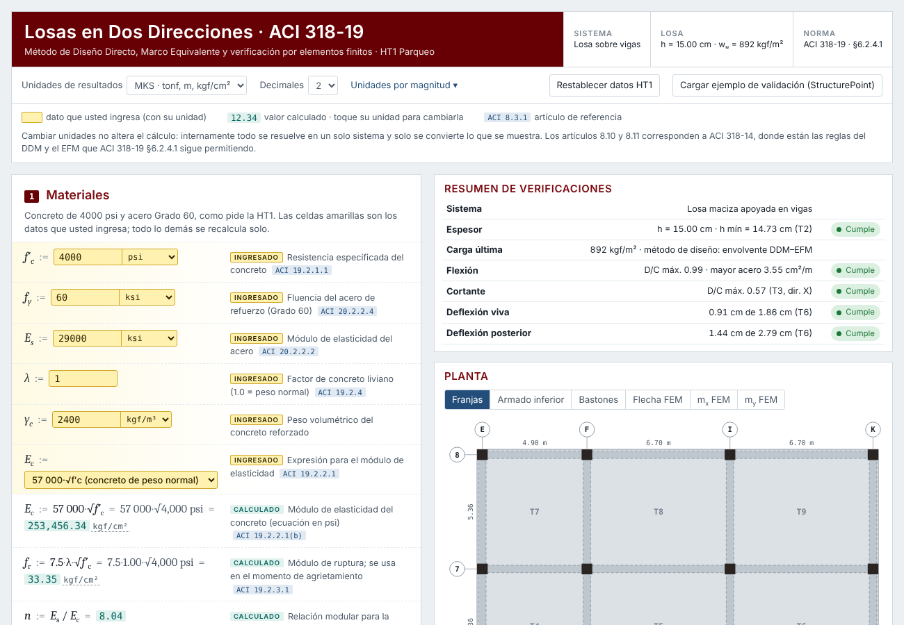

# Losas en dos direcciones · ACI 318-19


Hoja de cálculo interactiva para analizar, diseñar y verificar **losas macizas de concreto reforzado en dos direcciones**, apoyadas monolíticamente sobre vigas de marcos estructurales, según **ACI 318-19**. Viene con un **manual técnico** que explica cada procedimiento, fórmula y figura. La hoja es un solo archivo HTML: no necesita instalación ni dependencias.

### [▶ Abrir la hoja interactiva](https://a-terron.github.io/Losas-2D/) · [📖 Leer el manual](https://a-terron.github.io/Losas-2D/manual/)



---

## Contenido

| Documento | Versión web | En el repositorio | Qué es |
|---|---|---|---|
| **Hoja de cálculo** | [abrir](https://a-terron.github.io/Losas-2D/) | [`Losas 2D - ACI 318-19.html`](Losas%202D%20-%20ACI%20318-19.html) | 12 secciones, de materiales a detallado, con gráficos, unidades intercambiables y resumen de verificaciones. |
| **Manual técnico** | [leer](https://a-terron.github.io/Losas-2D/manual/) | [`manual/`](manual/) | Una nota por sección de la hoja (S01–S12), 58 notas de concepto, 33 figuras, diagramas de flujo, verificación de fórmulas y resultados de la HT1. |
| **Versiones** | — | [`CHANGELOG.md`](CHANGELOG.md) · [Releases](https://github.com/A-Terron/Losas-2D/releases) | Qué cambió en cada versión; cada release trae la hoja y el manual listos para descargar. |

## Qué hace la hoja

- **Materiales:** $`E_c`$, $`f_r`$, $`n`$, $`\beta_1`$ y $`\varepsilon_{ty}`$ a partir de $`f'_c`$ y $`f_y`$.
- **Sistema:** losa apoyada en vigas (de borde e interiores) o sin vigas interiores; claros, columnas y vigas editables.
- **Espesor mínimo:** $`\alpha_f`$, $`\alpha_{fm}`$, $`\beta`$ y $`h_{mín}`$ (ACI 8.3.1).
- **Momentos:** Método de Diseño Directo y Marco Equivalente (ACI 318-14 §8.10 y §8.11, que ACI 318-19 §6.2.4.1 sigue permitiendo), con patrones de carga viva y envolvente.
- **Diseño:** acero por franja con barra y separación en múltiplos de 2.5 cm, cortante en una dirección, deflexiones inmediata y de largo plazo, y detallado (longitudes de desarrollo, ganchos, empalmes, bastones y refuerzo de esquina).
- **Verificación:** modelo de placa por elementos finitos y comparación con ETABS.
- **Unidades:** cambiar las unidades de datos o resultados no altera el cálculo.

## Cómo usarla

1. Abre la [hoja en línea](https://a-terron.github.io/Losas-2D/), o descarga el archivo HTML y ábrelo en cualquier navegador.
2. Cambia los datos en las **celdas amarillas**; las verdes son resultados y se recalculan al instante.
3. **Restablecer datos HT1** vuelve al proyecto del curso; **Cargar ejemplo de validación** carga el ejemplo de StructurePoint con el que se validó el Marco Equivalente.

La hoja recuerda tus últimos datos en el mismo navegador.

## Caso de estudio: HT1 · Parqueo

Retícula de 3 × 3 tableros (claros de 4.90, 6.70 y 6.70 m en X y 3 × 5.36 m en Y), losa de 15 cm sobre vigas de 35 × 60 cm y columnas de 50 × 50 cm, $`f'_c`$ = 4000 psi, Grado 60, sobrecarga muerta 50 kgf/m² y carga viva 250 kgf/m².

| Verificación | Resultado |
|---|---|
| Espesor | $`h`$ = 15 cm ≥ $`h_{mín}`$ = 14.73 cm (T2) |
| Carga última | $`w_u`$ = 892 kgf/m², envolvente DDM–EFM |
| Flexión | D/C máx. 0.99 |
| Cortante | D/C máx. 0.57 |
| Deflexiones | Viva 0.91 cm ≤ 1.86 cm · posterior 1.44 cm ≤ 2.79 cm |

Todos los valores intermedios están en [Ejemplo HT1 · resultados](https://a-terron.github.io/Losas-2D/manual/04%20Ejemplo%20HT1%20-%20resultados/).

## Usar el manual en Obsidian

La carpeta [`manual/`](manual/) es la misma bóveda de Obsidian (enlaces `[[...]]`, callouts y figuras incrustadas). Descarga el repositorio o el `.zip` del último [release](https://github.com/A-Terron/Losas-2D/releases) y abre `manual/` como bóveda, o cópiala dentro de la tuya.

La versión web se genera sola a partir de esa carpeta: no hay que editar dos copias.

## Versiones y actualizaciones

El repositorio sigue [versionado semántico](https://semver.org/lang/es/) simplificado:

- **v1.1, v1.2…** correcciones y mejoras de la hoja o del manual que no cambian cómo se usa.
- **v2.0** cambios grandes (nuevo método, nueva estructura de datos, otra edición del Código).

Para publicar una versión nueva:

1. Reemplazar `Losas 2D - ACI 318-19.html` y/o los archivos de `manual/` (mismos nombres).
2. Anotar los cambios en [`CHANGELOG.md`](CHANGELOG.md) y subir `version` en `mkdocs.yml`.
3. Hacer commit en `main` y crear la etiqueta (`git tag v1.1`) con su release.

Cada push a `main` vuelve a publicar la hoja y el manual en GitHub Pages ([flujo](.github/workflows/pages.yml)). Si el manual tiene un enlace roto, la publicación se detiene y la versión anterior sigue en línea.

## Estructura del repositorio

```text
├── Losas 2D - ACI 318-19.html   Hoja de cálculo (se publica como página principal)
├── manual/                      Manual técnico = bóveda de Obsidian
│   ├── 00 Inicio.md … 04 …      Índice, flujo general, notación, verificación, ejemplo HT1
│   ├── Secciones/               S01–S12, una nota por sección de la hoja
│   ├── Conceptos/               Notas cortas, una por idea o fórmula
│   └── Figuras/                 Esquemas SVG
├── web/                         Configuración de la versión web del manual
│   ├── obsidian_hook.py         Convierte [[enlaces]] y ![[figuras]] al construir
│   ├── overrides/               Estilos, KaTeX y Mermaid incluidos
│   ├── requirements.txt         Versiones fijas de MkDocs
│   └── img/                     Capturas del README
├── mkdocs.yml
├── .github/workflows/pages.yml  Publicación automática en GitHub Pages
├── CHANGELOG.md
└── LICENSE
```

Para ver el manual web en tu PC: `pip install -r web/requirements.txt` y luego `mkdocs serve`.

## Alcance y limitaciones

- Losas macizas con tableros rectangulares y cargas de gravedad uniformes.
- **No** diseña vigas ni columnas y **no** revisa punzonamiento (el enunciado del proyecto lo excluye).
- Los elementos finitos son solo una verificación; el diseño se hace con DDM y EFM.

## Aviso

Es una herramienta educativa del curso de Estructuras de Concreto Reforzado. Antes de usar los resultados en un diseño real, verifícalos con criterio profesional. El repositorio no incluye el texto de ACI 318 ni la bibliografía; solo cita sus secciones.

## Licencia

- **Código** (hoja HTML y `web/`): [MIT](LICENSE).
- **Manual y figuras** (`manual/`): [CC BY 4.0](https://creativecommons.org/licenses/by/4.0/deed.es). Los datos del enunciado pertenecen al curso.
