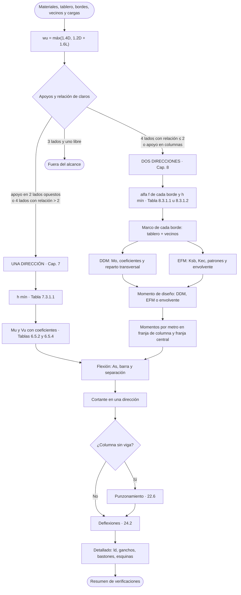

# Diagrama de flujo general

El recorrido de la hoja se bifurca una sola vez: en la [[S04 Clasificación del tablero|clasificación]]. De ahí en adelante cada rama usa su capítulo del Código, y las dos vuelven a encontrarse en flexión, cortante, deflexiones y detallado.

## Qué decide cada bifurcación

| Decisión | Dónde | Nota |
|---|---|---|
| Una o dos direcciones | Sección 4 | [[Una o dos direcciones]] |
| Tabla de espesor mínimo | Sección 5 | [[S05 Espesor mínimo]] |
| Caso del claro extremo del DDM | Sección 6 | [[Caso del claro extremo]] |
| Cómo termina el marco | Sección 7 | [[Marco del tablero]] |
| DDM, EFM o envolvente | Sección 8 | [[Envolvente DDM-EFM]] |
| Si hay punzonamiento | Sección 11 | [[Sección crítica de punzonamiento]] |
