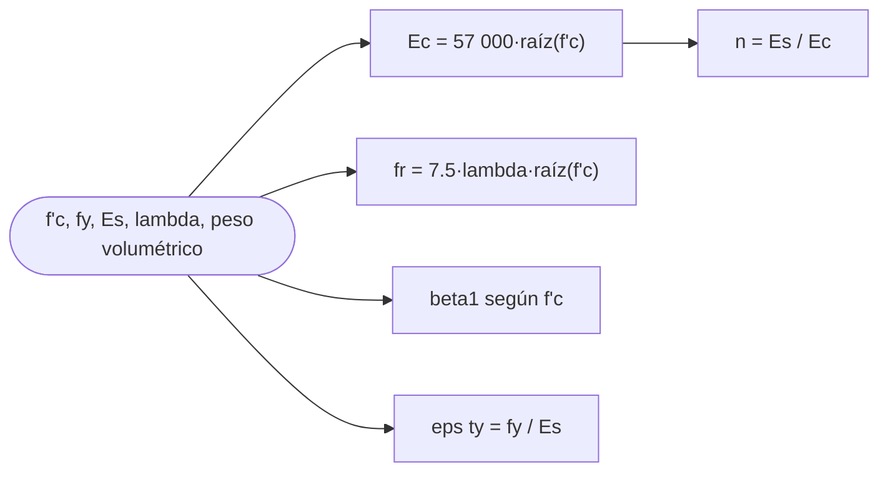

# S01 · Materiales

> [!abstract] En una frase
> A partir de $f'_c$ y $f_y$ se obtienen las propiedades que usa todo lo demás: $E_c$, $f_r$, $n$, $\beta_1$ y $\varepsilon_{ty}$.

## Por qué se hace

Las rigideces del marco equivalente y las deflexiones dependen de $E_c$; el agrietamiento, de $f_r$; la flexión, de $\beta_1$ y $\varepsilon_{ty}$. Es idéntico a la sección 1 de Losas 2D.

## Diagrama de flujo

## Procedimiento

$$E_c = 57\,000\sqrt{f'_c}\qquad f_r = 7.5\,\lambda\sqrt{f'_c}\qquad n=\frac{E_s}{E_c}\qquad \varepsilon_{ty}=\frac{f_y}{E_s}$$

Con $f'_c$ en psi. Si eliges la expresión con el peso volumétrico, $E_c = 33\,w_c^{1.5}\sqrt{f'_c}$. $\beta_1$ = 0.85 hasta 4000 psi y baja 0.05 por cada 1000 psi, sin pasar de 0.65.

Detalle de cada propiedad: [Módulo de elasticidad Ec](https://a-terron.github.io/Losas-2D/manual/Conceptos/M%C3%B3dulo%20de%20elasticidad%20Ec/), [Módulo de ruptura fr](https://a-terron.github.io/Losas-2D/manual/Conceptos/M%C3%B3dulo%20de%20ruptura%20fr/), [Relación modular n](https://a-terron.github.io/Losas-2D/manual/Conceptos/Relaci%C3%B3n%20modular%20n/), [Factor beta1](https://a-terron.github.io/Losas-2D/manual/Conceptos/Factor%20beta1/).

## Ejemplo · HT1

| Cantidad | Resultado |
|---|---|
| $E_c$ | 57 000·√4000 psi = 253 456 kgf/cm² |
| $f_r$ | 7.5·√4000 psi = 33.35 kgf/cm² |
| $n$ | 8.04 |
| $\beta_1$ | 0.85 |
| $\varepsilon_{ty}$ | 0.0021 |
