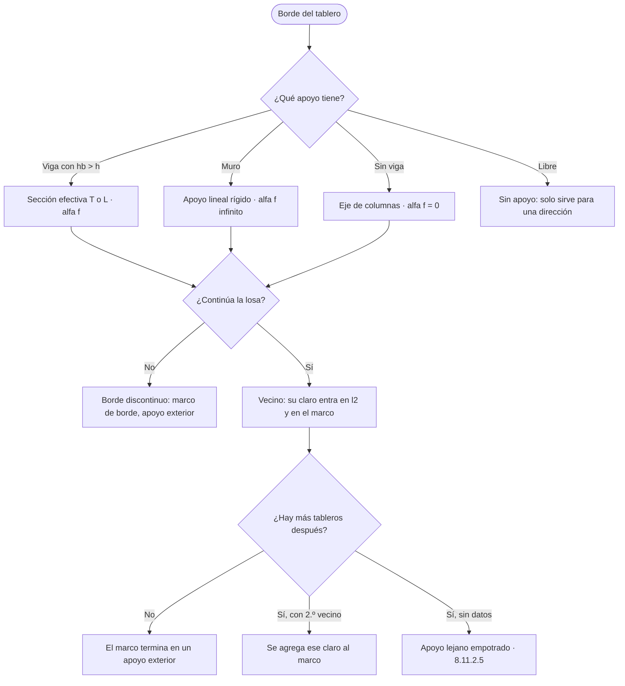

# S02 · Tablero, apoyos y continuidad

> [!abstract] En una frase
> Se describe un solo tablero y, borde por borde, en qué se apoya, si la losa continúa y qué tableros hay más allá: con eso la hoja reconstruye los marcos que el tablero necesita.

## Por qué se hace

Un tablero nunca trabaja solo. Su momento negativo depende del vecino con el que comparte apoyo, el ancho de cada marco incluye medio tablero vecino, y el Marco Equivalente necesita saber dónde termina la losa. En Losas 2D esa información sale de la retícula de 3 × 3; aquí la das tú.

![[U10-bordes-y-vecinos.svg]]

## Qué se ingresa

**Del tablero:** $\ell_x$, $\ell_y$, $h$, recubrimiento y lados de la columna $c_x$, $c_y$.

**De cada borde** (tabla «Bordes del tablero»):

| Columna | Opciones | Para qué sirve |
|---|---|---|
| Apoyo | Viga · muro de concreto · muro de mampostería · sin viga · borde libre | [[Tipos de apoyo de borde]] |
| Viga o muro | $b_w \times h_b$ (el peralte incluye la losa) o espesor del muro | $\alpha_f$, constante torsional, claro libre |
| ¿Continúa la losa? | Continuo · discontinuo | [[Posición del tablero]] y [[Caso del claro extremo]] |
| Claro del vecino | Medido perpendicular al borde | Ancho $\ell_2$ del marco y momento del apoyo compartido |
| Después del vecino | Hay más tableros · es el último · último con borde no restringido | Cómo termina el marco |
| 2.º vecino (opcional) | Claro, y si es el último o la losa sigue | Completa el marco; si se deja en 0 el apoyo se toma empotrado |

**De las columnas** (para el EFM): altura de la columna inferior, condición de su extremo lejano y, si existe, la columna superior.

Todo esto se explica en [[Continuidad y tableros vecinos]] y [[Marco del tablero]].

## Diagrama de flujo

## Qué cambia según el caso

| Caso | Efecto |
|---|---|
| Viga con $h_b \le h$ | No sobresale de la losa: se trata como «sin viga» |
| Borde discontinuo | El marco de ese borde es un marco de borde: $\ell_2$ = medio tablero más la distancia del eje al borde de la losa |
| Vecino de otro claro | Cambia $\ell_2$ y, en el apoyo compartido, gobierna el mayor de los dos momentos negativos |
| Losa sobre muros, sin columnas | Pon en $c_x$ y $c_y$ el espesor del muro para que el claro libre sea correcto |
| Apoyos de los vecinos | Se suponen iguales al del borde compartido; un vecino con otra viga no se puede describir |

## Ejemplo · HT1, tablero T5

$\ell_x$ = 6.70 m, $\ell_y$ = 5.36 m, $h$ = 15 cm, columnas de 50 × 50 cm. Los cuatro bordes: viga de 35 × 60 cm, continuo. Vecinos en X: 4.90 m (último) y 6.70 m (último); en Y: 5.36 m a cada lado (últimos). El marco de cada dirección queda con sus tres claros completos, igual que en el modelo.
