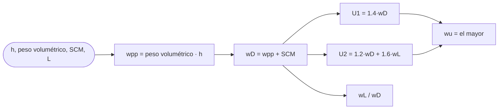

# S03 · Cargas

> [!abstract] En una frase
> Peso propio más sobrecarga muerta y carga viva, combinados en la carga última $w_u$ que usa todo el diseño.

## Procedimiento

$$w_{pp}=\gamma_c\,h\qquad w_D=w_{pp}+w_{SCM}\qquad w_u=\max(1.4\,w_D,\ 1.2\,w_D+1.6\,w_L)$$

La relación $w_L/w_D$ se usa tres veces: el DDM exige $L \le 2D$, los coeficientes de una dirección $L \le 3D$, y el Marco Equivalente revisa patrones de carga viva cuando $L/D > 0.75$. Ver [Combinaciones de carga y wu](https://a-terron.github.io/Losas-2D/manual/Conceptos/Combinaciones%20de%20carga%20y%20wu/) y [Patrones de carga viva](https://a-terron.github.io/Losas-2D/manual/Conceptos/Patrones%20de%20carga%20viva/).

## Qué cambia según el caso

| Caso | Efecto |
|---|---|
| Carga viva pequeña | Puede gobernar $1.4D$ |
| Vigas en el eje del marco | El peso del alma puede ir directo a la viga o repartirse en el ancho del marco (opción de la sección 6) |

## Ejemplo · HT1

$w_{pp}$ = 2400·0.15 = 360 kgf/m²; $w_D$ = 410 kgf/m²; $w_u$ = 1.2·410 + 1.6·250 = **892 kgf/m²**; $w_L/w_D$ = 0.61.
