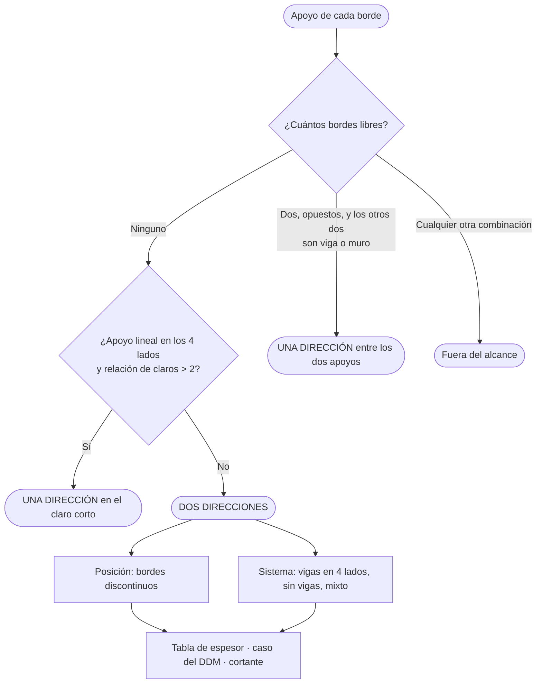

# S04 · Clasificación del tablero

> [!abstract] En una frase
> Con los apoyos de los cuatro bordes y la relación de claros la hoja decide si la losa trabaja en una o en dos direcciones y, si es en dos, qué caso de espesor, de DDM y de cortante le corresponde.

## Por qué se hace

Una y dos direcciones se diseñan con capítulos distintos del Código (7 y 8), con otro espesor mínimo, otro análisis y otro armado. Equivocarse aquí invalida todo lo demás.

## Diagrama de flujo

## Procedimiento

1. **Relación de claros** $\ell_{larga}/\ell_{corta}$, entre ejes.
2. **Conteo de apoyos:** lineales (viga o muro), sobre eje de columnas sin viga, y libres.
3. **Regla** de [[Una o dos direcciones]].
4. Si es en dos direcciones, se listan los **casos detectados**:

| Aspecto | Cómo se detecta | Nota |
|---|---|---|
| Posición | Número y ubicación de los bordes discontinuos | [[Posición del tablero]] |
| Sistema de piso | Qué bordes tienen viga o muro | [[Tipos de apoyo de borde]] |
| Tabla de espesor | Vigas en los cuatro lados y $\alpha_{fm}$ | [[S05 Espesor mínimo]] |
| Caso del DDM | Vigas del marco y del borde exterior | [[Caso del claro extremo]] |
| Marco | Claros y forma de sus extremos | [[Marco del tablero]] |
| Cortante | Si alguna columna recibe la losa sin viga | [[Sección crítica de punzonamiento]] |

Son los mismos casos de Losas 2D. Allí salen del sistema de piso elegido y de la posición de cada tablero en la retícula; aquí, de lo que indicas en cada borde.

## Forzar la clasificación

El selector permite forzar una dirección (solo con apoyo lineal en los cuatro lados) o dos direcciones, para comparar procedimientos. Déjalo en «Automática» para diseñar.

## Ejemplos

| Caso | Relación | Resultado |
|---|---|---|
| HT1 · T5, vigas en los cuatro lados | 6.70/5.36 = 1.25 | Dos direcciones · interior |
| Losa sobre vigas, 3.50 × 8.00 m | 2.29 | Una dirección ∥ X |
| Losa sobre dos muros, otros dos lados libres | — | Una dirección entre los muros |
| Placa plana de 6 × 6 m | 1.00 | Dos direcciones · sin vigas |

![[U01-planta-apoyos-franjas.png]]
