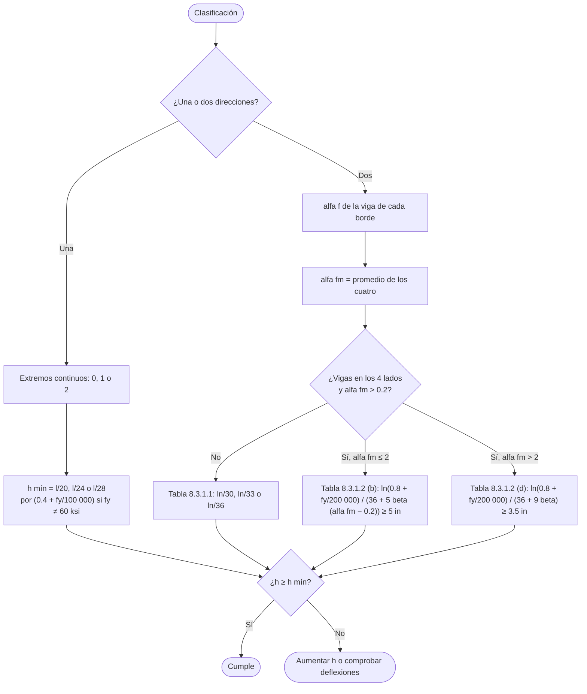

# S05 · Espesor mínimo

> [!abstract] En una frase
> Se compara el espesor de la losa con el mínimo del Código, que depende de la clasificación: Tabla 7.3.1.1 en una dirección, Tabla 8.3.1.1 u 8.3.1.2 en dos.

## Por qué se hace

Si $h \ge h_{mín}$ el Código no exige calcular deflexiones. Si no, el espesor solo vale cuando las deflexiones calculadas cumplen ([[S12 Deflexiones]]).

## Diagrama de flujo

## Procedimiento · dos direcciones

1. **Rigidez de cada viga de borde.** Sección efectiva en T (borde continuo) o en L (borde discontinuo), con vuelo igual a lo que la viga sobresale bajo la losa, sin pasar de $4h$. $\alpha_f = I_b/I_s$, con $I_s=\ell_2h^3/12$ del marco de ese borde. Ver [Sección efectiva de viga](https://a-terron.github.io/Losas-2D/manual/Conceptos/Secci%C3%B3n%20efectiva%20de%20viga/) y [Rigidez relativa alfa f](https://a-terron.github.io/Losas-2D/manual/Conceptos/Rigidez%20relativa%20alfa%20f/). Un muro cuenta como $\alpha_f=\infty$.
2. **Promedio** $\alpha_{fm}$ de los cuatro bordes.
3. **Claros libres** $\ell_{n,x}$ y $\ell_{n,y}$ entre caras de vigas o muros (o de columnas donde no hay viga) y $\beta=\ell_{n,largo}/\ell_{n,corto}$.
4. **Tabla que aplica:**

$$h_{mín}=\frac{\ell_n\left(0.8+\dfrac{f_y}{200\,000}\right)}{36+9\beta}\ \ge 3.5\ \text{in}\qquad(\alpha_{fm}>2)$$

Con $0.2<\alpha_{fm}\le2$ el denominador es $36+5\beta(\alpha_{fm}-0.2)$ y el mínimo 5 in. Si el tablero no tiene vigas en sus cuatro lados, o $\alpha_{fm}\le0.2$, aplica la Tabla 8.3.1.1.
5. **Borde discontinuo:** si su viga tiene $\alpha_f<0.8$, la Tabla 8.3.1.2 se aumenta 10 % y la 8.3.1.1 usa la columna «sin viga de borde».

Detalle en [Espesor mínimo de losa](https://a-terron.github.io/Losas-2D/manual/Conceptos/Espesor%20m%C3%ADnimo%20de%20losa/).

## Procedimiento · una dirección

Ver [[Espesor mínimo en una dirección]]: $h_{mín}=\ell/20$ (simplemente apoyada), $\ell/24$ (un extremo continuo) o $\ell/28$ (ambos), con $\ell$ entre ejes.

## Ejemplo · HT1, tablero T5

$\alpha_f$ = 7.11, 7.11, 6.57 y 5.69 → $\alpha_{fm}$ = 6.62 > 2. $\ell_{n,x}$ = 6.70 − 0.35 = 6.35 m, $\ell_{n,y}$ = 5.01 m, $\beta$ = 1.267.

$$h_{mín}=\frac{635\,(0.8+60\,000/200\,000)}{36+9(1.267)}=14.73\ \text{cm}\ \le 15\ \text{cm}$$

## Ejemplo · una dirección

Losa continua de 3.50 m, ambos extremos continuos: $h_{mín}$ = 350/28 = 12.5 cm.
