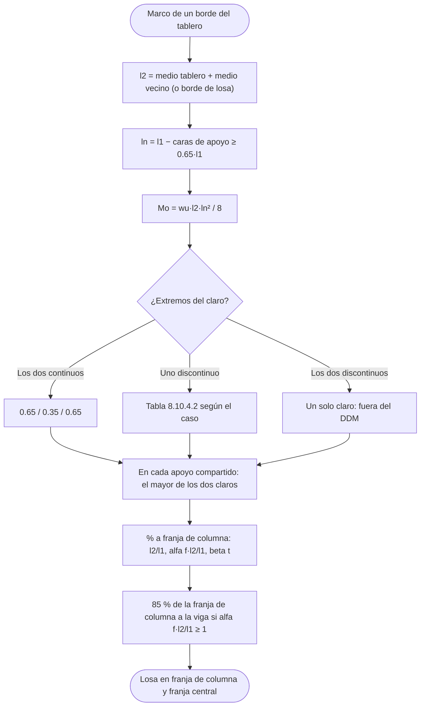
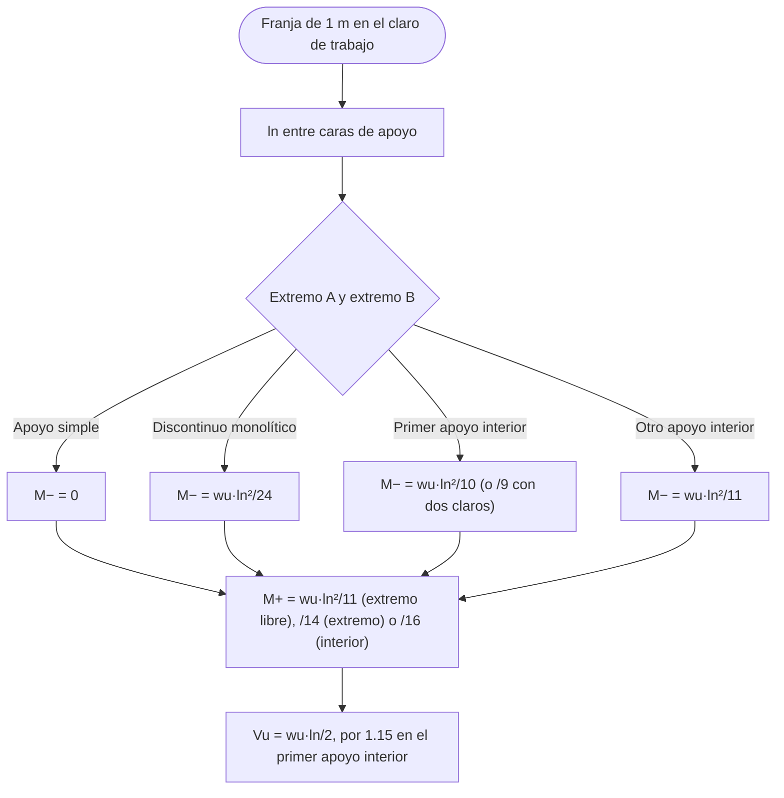

# S06 · Momentos: Diseño Directo (dos direcciones) o coeficientes (una dirección)

> [!abstract] En una frase
> En dos direcciones, el DDM reparte el momento estático $M_o$ de cada marco con coeficientes; en una dirección, la Tabla 6.5.2 da directamente los momentos de la franja de 1 m.

## Dos direcciones · Método de Diseño Directo

### Diagrama de flujo

### Procedimiento

1. **Limitaciones** (318-14 §8.10.2): tres claros, claros sucesivos que no difieran más de un tercio, relación ≤ 2, $L\le2D$ y relación de rigideces de vigas entre 0.2 y 5. La hoja las revisa con los datos de los vecinos; si alguna falla, diseña con el EFM. Ver [Limitaciones del DDM](https://a-terron.github.io/Losas-2D/manual/Conceptos/Limitaciones%20del%20DDM/).
2. **Momento estático** del marco de cada borde: [Marco de diseño y ancho l2](https://a-terron.github.io/Losas-2D/manual/Conceptos/Marco%20de%20dise%C3%B1o%20y%20ancho%20l2/), [Claro libre ln](https://a-terron.github.io/Losas-2D/manual/Conceptos/Claro%20libre%20ln/), [Momento estático Mo](https://a-terron.github.io/Losas-2D/manual/Conceptos/Momento%20est%C3%A1tico%20Mo/).
3. **Reparto longitudinal:** 0.65/0.35/0.65 en un claro interior; en un claro extremo, el [[Caso del claro extremo]]. El claro vecino lleva su propio momento al apoyo compartido y se diseña con el mayor (§8.10.4.5).
4. **Reparto transversal** con las tablas de §8.10.5: [Porcentajes de la franja de columna](https://a-terron.github.io/Losas-2D/manual/Conceptos/Porcentajes%20de%20la%20franja%20de%20columna/), [Rigidez torsional beta t](https://a-terron.github.io/Losas-2D/manual/Conceptos/Rigidez%20torsional%20beta%20t/), [Reparto entre viga y losa](https://a-terron.github.io/Losas-2D/manual/Conceptos/Reparto%20entre%20viga%20y%20losa/). Sobre un muro el momento negativo se reparte uniforme: [[Apoyo en muro]].

### Qué cambia según el caso

| Caso | Cambio |
|---|---|
| Marco de borde | $\ell_2$ más pequeño; en las tablas de reparto se usa el claro transversal completo |
| Tablero aislado | [[Tablero de un solo claro]] |
| Vecino con otro claro | Puede gobernar el momento negativo del vecino |
| Caso forzado | El selector «Caso del claro extremo» sustituye la detección automática |

### Ejemplo · HT1, T5, dirección X, marco del eje 6

$\ell_2$ = 5.36 m, $\ell_n$ = 6.70 − 0.50 = 6.20 m, $M_o$ = 0.892·5.36·6.20²/8 = **22.97 tonf·m**.

Claro interior: 14.93 / 8.04 / 14.93 tonf·m. En el eje I el vecino (claro extremo, 0.70) lleva 16.08 tonf·m, que gobierna. $\ell_2/\ell_1$ = 0.80 y $\alpha_{f1}\ell_2/\ell_1$ = 5.69 → 81 % a la franja de columna, de la que la viga toma el 85 %. Quedan para la losa 1.81 / 0.98 / 1.95 tonf·m en la franja de columna y 2.84 / 1.53 / 3.06 en la central.

## Una dirección · coeficientes de §6.5

Todas las reglas y sus condiciones están en [[Coeficientes de momento y cortante 6.5]].

### Ejemplo · losa continua de 3.50 m

$w_u$ = 814 kgf/m², $\ell_n$ = 3.25 m, claro interior: $M^-$ = 814·3.25²/11 = 782 kgf·m/m y $M^+$ = 814·3.25²/16 = 538 kgf·m/m.
