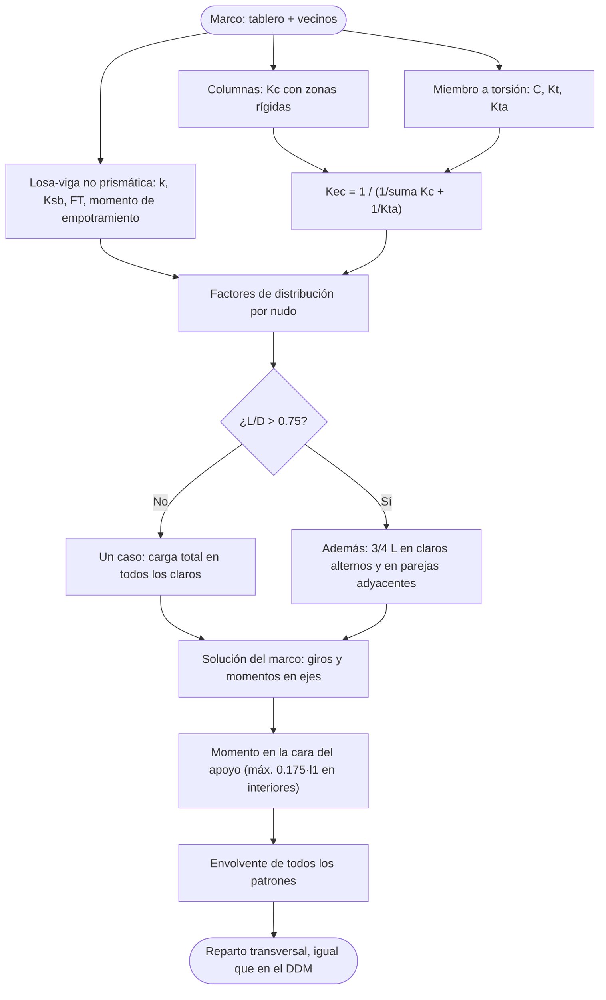

# S07 · Método del Marco Equivalente

> [!abstract] En una frase
> El tablero y sus vecinos forman un marco plano con losa-viga, columnas y miembros a torsión; se resuelve para la carga total y los patrones de carga viva, y de la envolvente salen los momentos en las caras de los apoyos.

## Por qué se hace

El DDM usa coeficientes fijos. El EFM calcula los momentos con las rigideces reales, así que capta lo que el DDM no ve: columnas flexibles, claros desiguales y patrones de carga. Además no tiene las limitaciones geométricas del DDM. Solo se usa en dos direcciones.

## El marco de un tablero

![[U11-marco-del-tablero.svg]]

Un tablero solo no es un marco. La hoja lo arma con el tablero y hasta dos vecinos por lado, y termina cada extremo de una de tres formas: apoyo exterior real, borde no restringido, o **empotrado** donde la losa sigue más allá de lo descrito. Ver [[Marco del tablero]].

## Diagrama de flujo

## Procedimiento

1. **Losa-viga.** Inercia $I_{sb}$ de la sección del marco y, entre el eje y la cara del apoyo, $I_{sb}/(1-c_2/\ell_2)^2$. De ahí salen el factor de rigidez $k$, el de transporte y el momento de empotramiento: [Miembro no prismático](https://a-terron.github.io/Losas-2D/manual/Conceptos/Miembro%20no%20prism%C3%A1tico/), [Rigidez de la losa-viga Ksb](https://a-terron.github.io/Losas-2D/manual/Conceptos/Rigidez%20de%20la%20losa-viga%20Ksb/).
2. **Columna equivalente.** [Rigidez de la columna Kc](https://a-terron.github.io/Losas-2D/manual/Conceptos/Rigidez%20de%20la%20columna%20Kc/), [Miembro a torsión Kt](https://a-terron.github.io/Losas-2D/manual/Conceptos/Miembro%20a%20torsi%C3%B3n%20Kt/) y

$$K_{ec}=\frac{1}{\dfrac{1}{\sum K_c}+\dfrac{1}{K_{ta}}}$$

   Ver [Columna equivalente Kec](https://a-terron.github.io/Losas-2D/manual/Conceptos/Columna%20equivalente%20Kec/). Un muro de concreto impide el giro ($K_{ec}=\infty$); uno de mampostería lo deja libre ($K_{ec}=0$).
3. **Factores de distribución** en cada nudo y **distribución de momentos**; la hoja muestra la tabla de Hardy Cross y resuelve el marco por rigideces: [Factores de distribución](https://a-terron.github.io/Losas-2D/manual/Conceptos/Factores%20de%20distribuci%C3%B3n/), [Distribución de momentos (Hardy Cross)](https://a-terron.github.io/Losas-2D/manual/Conceptos/Distribuci%C3%B3n%20de%20momentos%20%28Hardy%20Cross%29/).
4. **Patrones de carga viva** (ACI 6.4.3): [Patrones de carga viva](https://a-terron.github.io/Losas-2D/manual/Conceptos/Patrones%20de%20carga%20viva/). Para un marco de $n$ claros la hoja revisa todos cargados, los alternos y cada pareja adyacente a un apoyo interior.
5. **Momento de diseño en la cara** del apoyo: [Momento en la cara del apoyo](https://a-terron.github.io/Losas-2D/manual/Conceptos/Momento%20en%20la%20cara%20del%20apoyo/).
6. **Reparto transversal** con las mismas tablas del DDM.

La opción «Reducir los momentos cuando superan $M_o$» aplica §8.11.6.5.

## Qué cambia según el caso

| Caso | Cambio |
|---|---|
| Vecino último | El marco termina en una columna exterior con su viga de borde a torsión |
| Hay más tableros, sin 2.º vecino | Apoyo lejano empotrado (§8.11.2.5); diferencia de hasta 5 % en la HT1 |
| Hay más tableros, con 2.º vecino | El marco incluye ese claro |
| Tablero aislado | Marco de un claro con dos columnas exteriores |
| Columna superior | Suma su rigidez a $\sum K_c$ |
| Marco sobre un muro | La franja de columna descansa en el muro; $K_{ta}=\infty$ |

## Ejemplo · HT1, T5, dirección X, marco del eje 6

Marco de tres claros: 4.90 · **6.70** · 6.70 m, con columnas exteriores en los ejes E y K.

| Cantidad | Resultado |
|---|---|
| $I_{sb}$ | 1 601 835 cm⁴; entre eje y cara: 1 948 386 cm⁴ |
| $k$, factor de transporte, $m$ | 4.128 · 0.509 · 0.0843 |
| $K_{sb}$ | 25 017 tonf·m |
| $K_c$ (columna de 5.50 m, $k_c$ = 5.970) | 14 328 tonf·m |
| $C$, $K_t$, $K_{ta}$ | 622 356 cm⁴ · 71 062 · 755 085 tonf·m |
| $K_{ec}$ en el eje F | 14 062 tonf·m |
| Factores en el eje F (losa izq. / losa der. / columna) | 0.469 / 0.340 / 0.191 |
| Cargas del marco | $w_{u,D}$ = 2.64 tonf/m, $w_{u,L}$ = 2.14 tonf/m; $L/D$ = 0.61, sin patrones |
| Momentos en ejes (F / I) | 15.60 / 20.98 tonf·m |
| **Momentos de diseño en las caras** | **11.95 / 8.61 / 16.92 tonf·m** |

![[U04-momentos-marco.png]]
