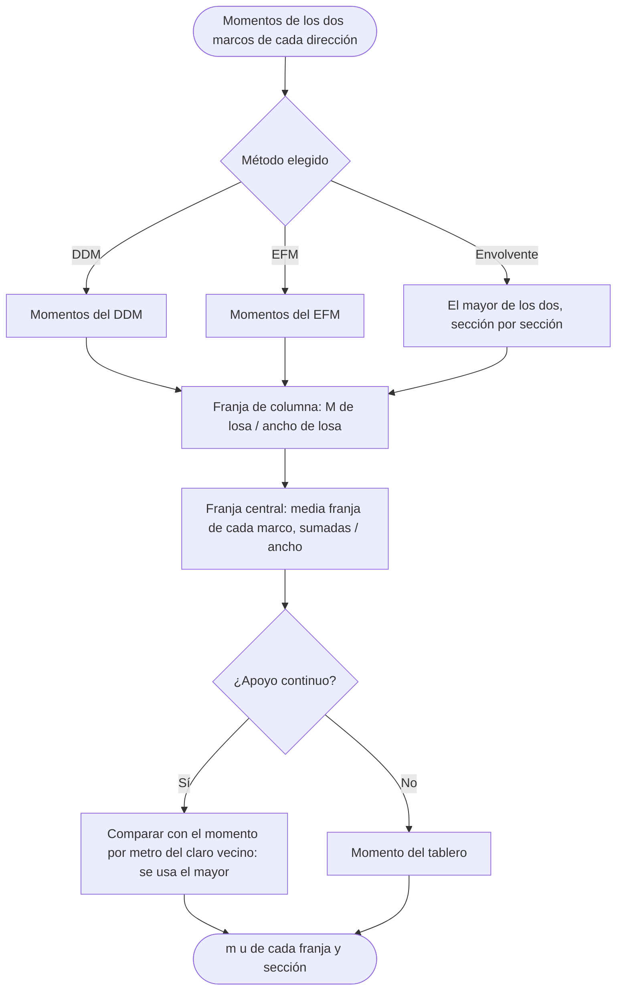

# S08 · Momentos de diseño: DDM · EFM

> [!abstract] En una frase
> Se elige con qué método se arma la losa y se convierten los momentos de los marcos en momentos por metro de ancho para cada franja del tablero.

## Por qué se hace

El acero se diseña por metro de losa, no por marco. Y los dos métodos no dan lo mismo: la envolvente protege la sección donde cualquiera de los dos es mayor.

## Diagrama de flujo

## Procedimiento

1. **Método:** envolvente (por defecto), solo DDM o solo EFM. Ver [[Envolvente DDM-EFM]].
2. **Franjas del tablero.** En cada dirección hay dos medias franjas de columna (una de cada marco) y una franja central formada por las dos medias franjas centrales. Ver [[Franjas del tablero]].

$$m_{u,col}=\frac{M_{losa,\,fc}}{b_{fc}-b_w}\qquad m_{u,cen}=\frac{f_1M_{fcen,1}+f_2M_{fcen,2}}{b_{cen}}$$

   donde $f_i$ es la parte de la franja central del marco $i$ que cae dentro del tablero.
3. **Apoyos continuos.** El acero superior sobre un apoyo sirve a los dos tableros, así que se diseña con el mayor momento por metro de los dos claros.

La tabla de la hoja muestra, para cada sección, el valor del DDM, el del EFM, la diferencia y el de diseño.

## Qué cambia según el caso

| Caso | Cambio |
|---|---|
| El DDM no cumple sus limitaciones | Diseñar con EFM |
| Vecino más largo | Suele gobernar el momento del vecino en el apoyo compartido |
| Marco de borde | Su media franja central entra completa en el tablero |

## Ejemplo · HT1, T5, dirección X (tonf·m/m)

| Franja | Sección | DDM | EFM | Diseño |
|---|---|---|---|---|
| Columna (eje 6) | $M^-$ eje F | 0.779 | 0.623 | 0.779 |
| | $M^+$ | 0.419 | 0.449 | 0.449 |
| | $M^-$ eje I | 0.839 | 0.927 | 0.927 |
| Central | $M^-$ eje F | 1.427 | 1.091 | **1.427** |
| | $M^+$ | 0.570 | 0.610 | 0.610 |
| | $M^-$ eje I | 1.140 | 1.260 | **1.260** |

En el eje F gobierna el DDM (por el vecino corto) y en el eje I el EFM: por eso conviene la envolvente.
