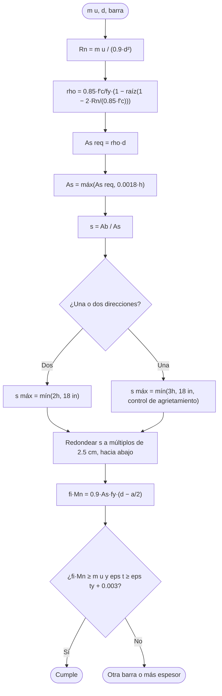

# S09 · Diseño por flexión

> [!abstract] En una frase
> Para cada momento por metro se calcula el acero requerido, se compara con el mínimo y se elige barra y separación dentro de los límites del Código.

## Diagrama de flujo

## Procedimiento

1. **Peralte efectivo** $d$: la capa exterior tiene $d=h-rec-d_b/2$ y la interior pierde un diámetro más. En una dirección el refuerzo principal va siempre en la capa exterior. [Peralte efectivo d](https://a-terron.github.io/Losas-2D/manual/Conceptos/Peralte%20efectivo%20d/).
2. **Acero requerido:** [Coeficiente Rn y cuantía](https://a-terron.github.io/Losas-2D/manual/Conceptos/Coeficiente%20Rn%20y%20cuant%C3%ADa/).
3. **Acero mínimo** $0.0018\,A_g$ en ambos capítulos (7.6.1.1 y 8.6.1.1): [Acero mínimo](https://a-terron.github.io/Losas-2D/manual/Conceptos/Acero%20m%C3%ADnimo/).
4. **Separación:** [Separación de barras](https://a-terron.github.io/Losas-2D/manual/Conceptos/Separaci%C3%B3n%20de%20barras/); en una dirección, [[Separación máxima en una dirección]].
5. **Resistencia y ductilidad:** [Resistencia de diseño a flexión](https://a-terron.github.io/Losas-2D/manual/Conceptos/Resistencia%20de%20dise%C3%B1o%20a%20flexi%C3%B3n/), [Sección controlada por tensión](https://a-terron.github.io/Losas-2D/manual/Conceptos/Secci%C3%B3n%20controlada%20por%20tensi%C3%B3n/).
6. **Una dirección:** además, [[Acero de retracción y temperatura]] en la dirección perpendicular.

En la hoja, toca una fila de la tabla de armado para ver su cálculo completo.

## Qué cambia según el caso

| | Dos direcciones | Una dirección |
|---|---|---|
| Secciones | 9 por dirección (3 franjas × 3 secciones) | 3 (dos apoyos y el centro) |
| $s_{máx}$ | mín($2h$, 18 in) | mín($3h$, 18 in) y 24.3.2 |
| Dirección perpendicular | También es refuerzo principal | Retracción y temperatura |

## Ejemplo · HT1, T5, franja central X, $M^-$ eje F

$m_u$ = 1.427 tonf·m/m, $d$ = 15 − 2 − 0.95 − 0.48 = 11.57 cm.

| Cantidad | Resultado |
|---|---|
| $R_n$ | 142 700/(0.9·100·11.57²) = 11.85 kgf/cm² |
| $\rho$ | 0.288 % → $A_{s,req}$ = 3.33 cm²/m |
| $A_{s,mín}$ | 0.0018·15·100 = 2.70 cm²/m |
| $s$ | 0.71/3.33 = 21.3 cm → **#3 @ 20 cm** (3.55 cm²/m) |
| $\phi M_n$ | 1.52 tonf·m/m → D/C = 0.94 |
| $\varepsilon_t$ | 0.044 ≥ 0.0051 |

![[U05-armado-inferior.png]]
