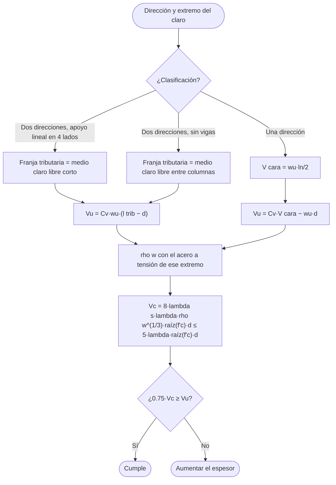

# S10 · Cortante en una dirección

> [!abstract] En una frase
> En cada dirección se compara el cortante último por metro, a una distancia $d$ de la cara de cada apoyo, con la resistencia del concreto sin estribos.

## Diagrama de flujo

## Procedimiento

$$V_c=8\,\lambda_s\lambda\,\rho_w^{1/3}\sqrt{f'_c}\,b_wd\ \le\ 5\,\lambda\sqrt{f'_c}\,b_wd\qquad \lambda_s=\sqrt{\frac{2}{1+d/10}}\le1$$

- Demanda: [Cortante último Vu](https://a-terron.github.io/Losas-2D/manual/Conceptos/Cortante%20%C3%BAltimo%20Vu/). Resistencia: [Resistencia a cortante Vc](https://a-terron.github.io/Losas-2D/manual/Conceptos/Resistencia%20a%20cortante%20Vc/) y [Efecto de tamaño lambda s](https://a-terron.github.io/Losas-2D/manual/Conceptos/Efecto%20de%20tama%C3%B1o%20lambda%20s/).
- $C_v$ = 1.15 en el primer apoyo interior de un claro extremo (Tabla 6.5.4); en dos direcciones es opcional.
- La hoja revisa **los dos extremos** y reporta el que gobierna: [[Cortante en los dos extremos]].
- En un apoyo simple la tensión por flexión está abajo: $\rho_w$ se toma con el acero inferior.

## Ejemplo · HT1, T5, dirección X

Franja tributaria = 5.01/2 = 2.505 m; $d$ = 11.57 cm; $V_u$ = 892·(2.505 − 0.116) = **2131 kgf/m** en ambos extremos.

| Extremo | Acero superior | $\rho_w$ | $\phi V_c$ | D/C |
|---|---|---|---|---|
| Eje F | #3 @ 20 cm | 0.307 % | 4485 kgf/m | 0.48 |
| Eje I | #3 @ 22.5 cm | 0.273 % | 4312 kgf/m | **0.49** |
