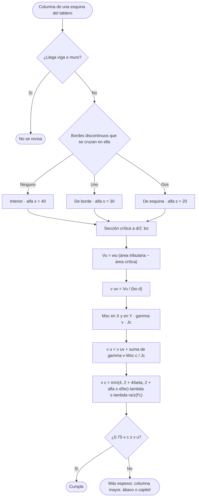

# S11 · Cortante en dos direcciones (punzonamiento)

> [!abstract] En una frase
> Donde la losa descarga directamente en una columna se compara el esfuerzo cortante en una sección crítica a $d/2$ de sus caras, incluida la transferencia de momento, con la resistencia del concreto.

## Cuándo se hace

Solo en dos direcciones y solo en las columnas a las que **no llega viga ni muro** por ninguno de los dos bordes. Con vigas en los cuatro lados la carga viaja por ellas y la sección muestra «No aplica». Losas 2D no hace esta revisión porque el enunciado del proyecto la excluye; aquí se incluye porque la hoja admite placas planas.

## Diagrama de flujo

## Procedimiento

1. **Tipo de columna y sección crítica:** [[Sección crítica de punzonamiento]].

![[U12-punzonamiento.svg]]

2. **Cortante directo.** El área tributaria llega hasta la mitad de cada tablero que rodea la columna (por eso se usan los claros de los vecinos):

$$V_u=w_u\,(A_{trib}-A_{crít})\qquad v_{uv}=\frac{V_u}{b_o\,d}$$

   con $d$ = promedio de los dos peraltes efectivos superiores (22.6.2.1).
3. **Momento transferido:** [[Transferencia de momento losa-columna]].

$$v_u=v_{uv}+\sum\frac{\gamma_v\,M_{sc}\,c}{J_c}$$

4. **Resistencia** (Tabla 22.6.5.2), con $\beta$ = lado largo / lado corto de la columna:

$$v_c=\min\left(4,\ 2+\frac{4}{\beta},\ 2+\frac{\alpha_s d}{b_o}\right)\lambda_s\lambda\sqrt{f'_c}\qquad \phi=0.75$$

5. **Verificaciones asociadas:** acero dentro de $b_{slab}$ para $\gamma_fM_{sc}$ y [[Acero mínimo sobre la columna]].

## Qué cambia según el caso

| Caso | Cambio |
|---|---|
| Columna de borde o esquina | Menos perímetro y más momento transferido: suele gobernar |
| Columna rectangular alargada | $2+4/\beta$ reduce $v_c$ |
| Losa gruesa | $\lambda_s<1$ |
| Viga por un solo borde | Fuera del alcance: la hoja lo indica |

## Ejemplo · placa plana de 6 × 6 m, columna interior

$h$ = 20 cm, columnas de 50 cm, $w_u$ = 1096 kgf/m², $d$ = 16.73 cm.

| Cantidad | Resultado |
|---|---|
| $b_o$ | 4·(50 + 16.73) = 266.9 cm |
| $V_u$ | 1096·(36 − 0.667²) = 38 970 kgf |
| $v_{uv}$ | 38 970/(266.9·16.73) = 8.73 kgf/cm² |
| $M_{sc}$ por dirección | 0.07·0.5·(1.6·250)·6·5.5² = 2541 kgf·m |
| $\gamma_v$, $J_c$ | 0.40 · 3.37 × 10⁶ cm⁴ |
| Aumento por momento | 1.01 kgf/cm² por dirección |
| $v_u$ | 8.73 + 2·1.01 = **10.75 kgf/cm²** |
| $\phi v_c$ | 0.75·4·√4000 psi = **13.34 kgf/cm²** → D/C = 0.81 |
