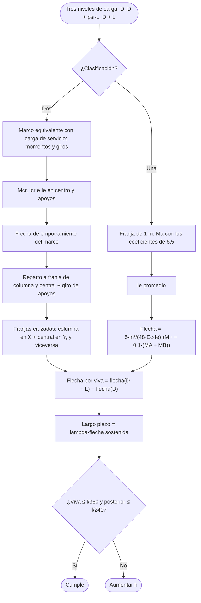

# S12 · Deflexiones

> [!abstract] En una frase
> Se calcula la flecha inmediata por carga viva y la de largo plazo por cargas sostenidas, con la inercia efectiva de ACI 318-19, y se comparan con $\ell/360$ y $\ell/240$.

## Cuándo se hace

Siempre, como verificación. El Código solo la exige si $h<h_{mín}$.

## Diagrama de flujo

## Procedimiento · dos direcciones

Es el método de Losas 2D aplicado a los dos marcos de cada dirección: [Método de las franjas cruzadas](https://a-terron.github.io/Losas-2D/manual/Conceptos/M%C3%A9todo%20de%20las%20franjas%20cruzadas/).

1. Momentos de servicio y giros de los nudos: del **marco equivalente** resuelto con carga unitaria.
2. [Momento de agrietamiento Mcr](https://a-terron.github.io/Losas-2D/manual/Conceptos/Momento%20de%20agrietamiento%20Mcr/), [Inercia agrietada Icr](https://a-terron.github.io/Losas-2D/manual/Conceptos/Inercia%20agrietada%20Icr/) e [Inercia efectiva Ie](https://a-terron.github.io/Losas-2D/manual/Conceptos/Inercia%20efectiva%20Ie/) en el centro y en los apoyos, con el acero colocado; promedio ponderado 0.70/0.15/0.15 (claro interior) o 0.85/0.15 (claro extremo).
3. Flecha del marco empotrado y su reparto:

$$\Delta_{emp}=\frac{w\,\ell^4}{384\,E_cI_e}\qquad \Delta_c=FDL_c\,\Delta_{emp}\frac{I_g}{I_c}+\Delta_\theta\qquad \Delta_m=FDL_m\,\Delta_{emp}\frac{I_g}{I_m}+\Delta_\theta$$

   con $\Delta_\theta=(\theta_A-\theta_B)\,\ell/8\cdot I_g/I_e$.
4. Flecha del tablero: centro respecto a las columnas, o franja central respecto a sus vigas ([Flecha relativa a las vigas](https://a-terron.github.io/Losas-2D/manual/Conceptos/Flecha%20relativa%20a%20las%20vigas/)), según la opción elegida.
5. [Deflexión a largo plazo](https://a-terron.github.io/Losas-2D/manual/Conceptos/Deflexi%C3%B3n%20a%20largo%20plazo/) y [Límites de deflexión](https://a-terron.github.io/Losas-2D/manual/Conceptos/L%C3%ADmites%20de%20deflexi%C3%B3n/).

## Procedimiento · una dirección

Franja de 1 m con $I_g=bh^3/12$ y los momentos de servicio de los mismos coeficientes de §6.5:

$$\Delta=\frac{5\,\ell_n^2}{48\,E_cI_e}\left[M_a^+-0.1\,(M_{a,A}+M_{a,B})\right]$$

## Ejemplo · HT1, T5

Gobierna la franja central en X, respecto a las vigas. Marco del eje 6 con carga total: $w$ = 3.92 tonf/m, $M_a^+$ = 7.05 < ⅔·$M_{cr}$ = 7.49 tonf·m en el centro, pero los apoyos sí se agrietan → $I_e/I_g$ = 0.765. $\Delta_{emp}$ = 0.049 cm; franja central: 0.190·0.049·21.25 − 0.003 = 0.193 cm.

| Cantidad | Resultado | Límite |
|---|---|---|
| $\Delta_D$, $\Delta_{sost}$, $\Delta_{D+L}$ | 0.126 · 0.143 · 0.193 cm | |
| $\Delta_L$ | 0.068 cm | 670/360 = 1.86 cm |
| $\Delta_{LP}=2\cdot\Delta_{sost}$ | 0.285 cm | |
| $\Delta_{post}$ | 0.353 cm | 670/240 = 2.79 cm |
