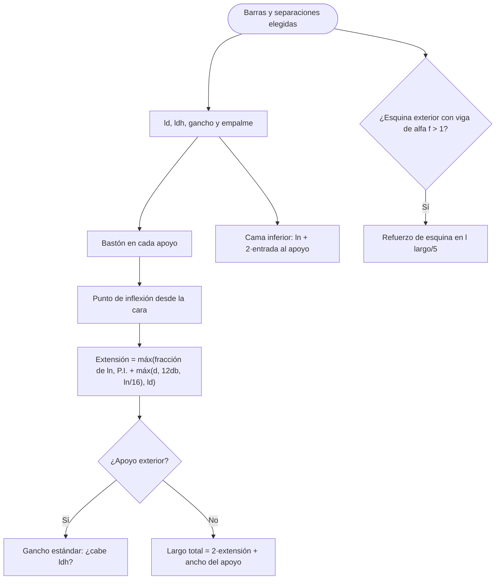

# S13 · Detallado del refuerzo

> [!abstract] En una frase
> Qué barra va, dónde y hasta dónde: longitudes de desarrollo, ganchos, empalmes, extensión de los bastones y refuerzo de esquina.

## Diagrama de flujo

## Procedimiento

1. **Longitudes básicas:** [Longitud de desarrollo ld](https://a-terron.github.io/Losas-2D/manual/Conceptos/Longitud%20de%20desarrollo%20ld/), [Gancho estándar ldh](https://a-terron.github.io/Losas-2D/manual/Conceptos/Gancho%20est%C3%A1ndar%20ldh/), [Empalme por traslape](https://a-terron.github.io/Losas-2D/manual/Conceptos/Empalme%20por%20traslape/).
2. **Bastones superiores:** [[Puntos de inflexión y bastones]] y [Extensión de bastones](https://a-terron.github.io/Losas-2D/manual/Conceptos/Extensi%C3%B3n%20de%20bastones/). En dos direcciones la fracción mínima es 0.30$\ell_n$ en franja de columna y 0.22$\ell_n$ en franja central (Fig. 8.7.4.1.3), y en losas sin vigas no menos de $5d$.
3. **Cama inferior** corrida de apoyo a apoyo, con entrada de 150 mm: [Anclaje del refuerzo inferior](https://a-terron.github.io/Losas-2D/manual/Conceptos/Anclaje%20del%20refuerzo%20inferior/).
4. **Refuerzo de esquina** (8.7.3) en las esquinas donde se cruzan dos bordes discontinuos con viga de $\alpha_f>1$ o muro: [Refuerzo de esquina](https://a-terron.github.io/Losas-2D/manual/Conceptos/Refuerzo%20de%20esquina/).
5. **Losas sin vigas:** dos barras inferiores de la franja de columna, en cada dirección, pasan por el núcleo de la columna (8.7.4.2).

En una dirección la extensión mínima es 0.30$\ell_n$ en apoyos continuos y 0.25$\ell_n$ en exteriores, y el acero transversal de temperatura va sobre la cama inferior.

## Ejemplo · HT1, T5

$\ell_d$ = 36.1 cm, $\ell_{dh}$ = 15.2 cm, empalme clase B = 47.0 cm (barra #3).

| Bastón, dirección X | Punto de inflexión | Franja de columna | Franja central |
|---|---|---|---|
| Eje F | 1.04 m | 1.90 m | 1.45 m |
| Eje I | 1.37 m | 1.90 m | 1.80 m |

Cama inferior en X: 6.20 + 2·0.152 → 6.55 m.

![[U06-bastones.png]]

![[U07-seccion-armado.png]]
