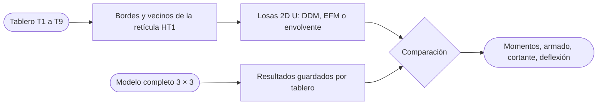

# S14 · Comparación con el modelo completo (HT1)

> [!abstract] En una frase
> Los nueve tableros de la HT1, resueltos uno por uno con esta hoja, dan lo mismo que el modelo de 3 × 3 tableros de Losas 2D.

## Cómo se compara

La hoja trae guardados los resultados del modelo completo (Losas 2D v1.0) para cada tablero y cada método. Al elegir un tablero, lo resuelve en el momento con sus vecinos y muestra, sección por sección, el momento por metro, la diferencia y el armado de las dos hojas. El botón **Cargar … en la hoja** pasa ese tablero a las secciones 1 a 13 para ver su paso a paso.

## Resultados

| Tablero | $h_{mín}$ (cm) | Diferencia de momentos | Armados iguales | Cortante D/C · hoja / modelo | $\Delta_{post}$ (cm) · hoja / modelo |
|---|---|---|---|---|---|
| T1, T7 (esquina) | 12.00 | 0 % | 18 de 18 | 0.50 / 0.50 | 0.190 / 0.190 |
| T2, T8 (borde) | 14.73 | 0 % | 18 de 18 | 0.56 / 0.56 | 0.383 / 0.383 |
| T3, T9 (esquina) | 14.73 | 0 % | 18 de 18 | 0.57 / 0.57 | 0.929 / 0.929 |
| T4 (borde) | 12.00 | 0 % | 18 de 18 | 0.49 / 0.49 | 0.160 / 0.160 |
| T5 (interior) | 14.73 | 0 % | 18 de 18 | 0.49 / 0.48 | 0.353 / 0.353 |
| T6 (borde) | 14.73 | 0 % | 18 de 18 | 0.57 / 0.57 | 1.439 / 1.439 |

Valores con la envolvente DDM–EFM; con cada método por separado la coincidencia es la misma.

## Lectura

- **Coincidencia exacta** en momentos, acero, espesor y deflexiones: un tablero con los claros de sus vecinos reproduce el marco completo.
- **Cortante:** misma demanda; la resistencia de esta hoja puede ser algo menor porque revisa los dos extremos ([[Cortante en los dos extremos]]). Se ve en T5: 0.49 frente a 0.48.
- **Bastones:** la extensión puede diferir un múltiplo de redondeo ([[Puntos de inflexión y bastones]]).
- **Si no se da el segundo vecino**, el extremo lejano se toma empotrado y los momentos del EFM cambian hasta 5 % ([[Marco del tablero]]).

Más detalle en [[03 Validación]].
