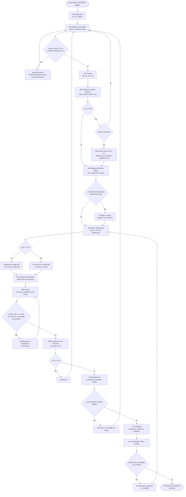

# Diagrama de flujo general

Recorrido completo del diseño de la losa, en el orden en que lo hace la hoja. Cada caja lleva a su nota de sección; los rombos son las decisiones que cambian el camino.

## Cómo leerlo

- **El espesor manda al principio.** Casi todas las vueltas hacia atrás regresan a la geometría porque subir $h$ cambia el peso propio, la rigidez $\alpha_f$, los momentos, el cortante y las deflexiones a la vez.
- **DDM y EFM corren en paralelo.** No son pasos sucesivos: son dos formas de obtener los mismos momentos. La hoja calcula ambos y diseña con la envolvente, salvo que elijas uno.
- **El FEM va al final** porque el proyecto lo pide solo como verificación independiente, no como método principal.

## Diagramas por sección

Cada nota de sección trae su propio diagrama con todos los pasos internos:

[[S01 Materiales]] · [[S02 Sistema estructural y geometría]] · [[S03 Cargas]] · [[S04 Rigidez de vigas y espesor mínimo]] · [[S05 Método de Diseño Directo]] · [[S06 Método del Marco Equivalente]] · [[S07 Momentos de diseño y comparación]] · [[S08 Diseño por flexión]] · [[S09 Cortante en una dirección]] · [[S10 Deflexiones]] · [[S11 Detallado del refuerzo]] · [[S12 Verificación FEM y ETABS]]

Volver a [[00 Inicio]].
