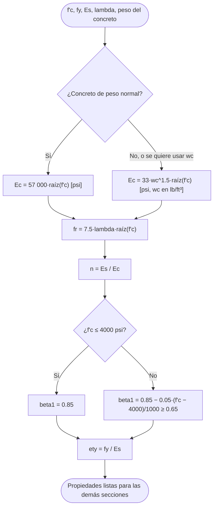

# S01 · Materiales

> [!abstract] En una frase
> Con $f'_c$, $f_y$ y el peso del concreto se obtienen las propiedades derivadas que usa todo lo demás: $E_c$, $f_r$, $n$, $\beta_1$ y $\varepsilon_{ty}$.

## Por qué se hace

Ninguna de estas propiedades se mide en obra para un proyecto normal: el Código da expresiones para estimarlas a partir de $f'_c$. Se calculan primero porque aparecen en rigideces ($E_c$), agrietamiento ($f_r$), sección agrietada ($n$), bloque de compresión ($\beta_1$) y control de ductilidad ($\varepsilon_{ty}$).

## Cuándo se hace

Una sola vez, al inicio. Se repite solo si cambias $f'_c$, $f_y$ o el tipo de concreto.

## Datos y resultados

| Entra (celdas amarillas) | Sale |
|---|---|
| $f'_c$ = 4000 psi · $f_y$ = 60 ksi · $E_s$ = 29 000 ksi · $\lambda$ = 1.0 · $\gamma_c$ = 2400 kgf/m³ | $E_c$, $f_r$, $n$, $\beta_1$, $\varepsilon_{ty}$ |

## Diagrama de flujo

## Procedimiento

### Paso 1 · Módulo de elasticidad del concreto

$$E_c = 57\,000\sqrt{f'_c}\quad\text{(psi)}\qquad\text{o}\qquad E_c = w_c^{1.5}\,33\sqrt{f'_c}\quad\text{(psi, } w_c \text{ en lb/ft}^3)$$

- **Por qué:** $E_c$ convierte momentos en deformaciones; define todas las rigideces del marco equivalente y de las deflexiones.
- **Cómo:** $f'_c$ va en psi **dentro** de la raíz y el resultado sale en psi.
- **Referencia:** ACI 19.2.2.1. Detalle en [[Módulo de elasticidad Ec]].

### Paso 2 · Módulo de ruptura

$$f_r = 7.5\,\lambda\sqrt{f'_c}\quad\text{(psi)}$$

- **Por qué:** es el esfuerzo de tensión al que se agrieta el concreto; con él se obtiene [[Momento de agrietamiento Mcr]].
- **Referencia:** ACI 19.2.3.1. Detalle en [[Módulo de ruptura fr]].

### Paso 3 · Relación modular

$$n = \frac{E_s}{E_c}$$

- **Por qué:** permite transformar el acero en concreto equivalente para calcular [[Inercia agrietada Icr]]. Detalle en [[Relación modular n]].

### Paso 4 · Factor del bloque de compresión

$$\beta_1 = \begin{cases}0.85 & f'_c \le 4000\text{ psi}\\[2pt] 0.85-0.05\,\dfrac{f'_c-4000}{1000}\ \ge 0.65 & f'_c > 4000\text{ psi}\end{cases}$$

- **Por qué:** relaciona la profundidad del bloque rectangular $a$ con la del eje neutro $c$: $a = \beta_1 c$. Se necesita para comprobar la [[Sección controlada por tensión]].
- **Referencia:** ACI 22.2.2.4.3. Detalle en [[Factor beta1]].

### Paso 5 · Deformación de fluencia

$$\varepsilon_{ty} = \frac{f_y}{E_s}$$

- **Por qué:** la losa debe cumplir $\varepsilon_t \ge \varepsilon_{ty} + 0.003$ (ACI 8.3.3.1 y 21.2.2) para poder usar $\phi = 0.90$.

## Qué cambia según el caso

| Caso | Cambio |
|---|---|
| Concreto liviano | $\lambda$ < 1.0 (0.75 a 0.85): bajan $f_r$, $V_c$ y suben $\ell_d$, $\ell_{dh}$. Conviene la expresión de $E_c$ con $w_c$. |
| $f'_c$ > 4000 psi | $\beta_1$ baja de 0.85. |
| Acero Grado 80 o 100 | Cambia $\varepsilon_{ty}$, el factor $\psi_g$ del desarrollo y el término $(0.8 + f_y/200\,000)$ del espesor mínimo. |

## Ejemplo HT1

| Propiedad | Operación | Resultado |
|---|---|---|
| $E_c$ | $57\,000\sqrt{4000}$ | 3 605 000 psi = 253 456 kgf/cm² |
| $f_r$ | $7.5\cdot 1.0\cdot\sqrt{4000}$ | 474.3 psi = 33.35 kgf/cm² |
| $n$ | 29 000 / 3605 | 8.04 |
| $\beta_1$ | $f'_c$ = 4000 psi | 0.85 |
| $\varepsilon_{ty}$ | 60 / 29 000 | 0.00207 |

## Errores frecuentes

- Meter $f'_c$ en kgf/cm² o MPa dentro de $57\,000\sqrt{f'_c}$. La constante 57 000 solo vale con psi.
- Olvidar que $\gamma_c$ = 2400 kgf/m³ es del concreto **reforzado** y se usa para el peso propio, no para $E_c$ (salvo que elijas la expresión con $w_c$).

Siguiente: [[S02 Sistema estructural y geometría]] · Índice: [[00 Inicio]]
