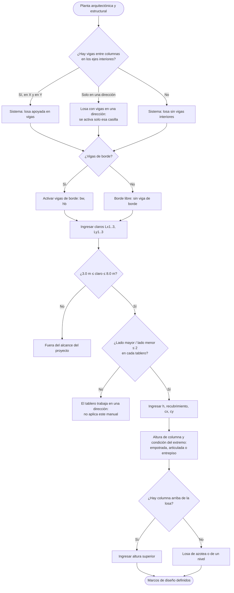

# S02 · Sistema estructural y geometría

> [!abstract] En una frase
> Se define **qué tipo de losa es** (con vigas o sin vigas interiores), **qué vigas existen** y **las dimensiones** de claros, losa, columnas y vigas; de aquí salen los marcos de diseño.

## Por qué se hace

El tipo de sistema decide casi todo lo que viene: qué tabla de espesor mínimo aplica, qué coeficientes usa el Diseño Directo, cuánto momento toma la viga, cómo se revisa el cortante y cómo se detallan los bastones. Por eso la hoja lo pregunta antes que las cargas.

## Cuándo se hace

Al inicio, y cada vez que una verificación posterior obliga a cambiar el espesor o las vigas (ver [[01 Diagrama de flujo general]]).

## Los dos sistemas

![[F02-sistemas-de-piso.svg]]

| | Losa apoyada en vigas (*two-way beam-supported slab*) | Losa sin vigas interiores (*two-way slab system*, placa plana) |
|---|---|---|
| Apoyo | Vigas entre columnas en los cuatro lados de cada tablero | Directamente sobre las columnas |
| Vigas de borde | Normalmente sí | Opcionales (mejoran el borde) |
| Espesor típico | Menor (aquí 15 cm) | Mayor (aquí unos 19 a 21 cm) |
| Lo que gobierna | Flexión con acero mínimo, deflexión | Deflexión y **punzonamiento** |

Detalle en [[Sistemas de piso en dos direcciones]].

## Diagrama de flujo

## Procedimiento

### Paso 1 · Elegir el sistema y las vigas

- **Cómo:** botón de sistema y tres casillas: vigas interiores paralelas a X, paralelas a Y y vigas de borde.
- **Por qué importa cada casilla:** una viga solo cuenta como apoyo rígido si su [[Rigidez relativa alfa f]] es suficiente; la hoja lo calcula en la sección 4.

### Paso 2 · Claros entre ejes

Tres claros en X ($L_{x1}$, $L_{x2}$, $L_{x3}$) y tres en Y ($L_{y1}$, $L_{y2}$, $L_{y3}$), medidos **entre ejes de columnas**. Límites del proyecto:

$$3.0\text{ m} \le L \le 8.0\text{ m}\qquad\qquad \frac{L_{mayor}}{L_{menor}} \le 2.0\ \text{en cada tablero}$$

- **Por qué el límite de 2:** con una relación mayor casi toda la carga viaja en la dirección corta y el tablero se comporta como losa en una dirección (ACI R8.3.1.2 remite entonces a 7.3.1).

### Paso 3 · Losa y columnas

- $h$: espesor. Se **verifica** en [[S04 Rigidez de vigas y espesor mínimo]].
- Recubrimiento libre: ver [[Recubrimiento]].
- $c_x$, $c_y$: lados de la columna. En cada dirección de análisis, $c_1$ es el lado paralelo al claro y $c_2$ el transversal.
- Altura de la columna inferior y condición del extremo lejano; columna superior si la hay. Solo afectan al [[Marco equivalente]] y al modelo FEM.

### Paso 4 · Vigas

Para cada grupo (interiores ∥X, interiores ∥Y, de borde): ancho del alma $b_w$ y peralte **total** $h_b$, que incluye el espesor de la losa.

### Paso 5 · Marcos de diseño

Con la geometría, cada eje de columnas define un **marco de diseño** en cada dirección: 4 marcos en X (ejes 5, 6, 7, 8) y 4 en Y (ejes E, F, I, K). Los de los ejes extremos son **marcos de borde**. Ver [[Marco de diseño y ancho l2]].

## Qué cambia según el caso

| Caso | Efecto en el resto del diseño |
|---|---|
| Con vigas en los cuatro lados | Tabla 8.3.1.2 para $h_{mín}$; coeficientes 0.16 / 0.57 / 0.70; la viga toma hasta 85 % de la franja de columna; cortante por áreas tributarias a 45°. |
| Sin vigas interiores, con viga de borde | Tabla 8.3.1.1 (columna «con viga de borde»); coeficientes 0.30 / 0.50 / 0.70; toda la franja de columna la resiste la losa. |
| Sin vigas | Tabla 8.3.1.1 (columna «sin viga de borde»); coeficientes 0.26 / 0.52 / 0.70; bastones de la franja de columna no menores que 5$d$; integridad estructural 8.7.4.2. |
| Columna arriba y abajo | Se suman las dos rigideces de columna en el nudo: apoyo más rígido, más momento negativo exterior. |
| Extremo inferior articulado | Rigidez de columna 3EI/L en lugar de 4EI/L (aprox.): menos momento exterior. |

## Ejemplo HT1

- Sistema: losa apoyada en vigas, con vigas interiores en X y en Y y vigas de borde.
- Claros: X = 4.90, 6.70, 6.70 m · Y = 5.36, 5.36, 5.36 m. Relación máxima 6.70/5.36 = **1.25** ≤ 2. ✔
- $h$ = 15 cm, recubrimiento 2 cm, columnas 50 × 50 cm, altura 5.50 m empotrada en la cimentación, sin columna superior.
- Vigas 35 × 60 cm en todos los ejes.

> [!note] Diferencias con el modelo de ETABS
> El modelo «HT1 - SHELLS» tiene losa de 10 cm y vigas secundarias de 30 × 50. Para comparar con esta hoja hay que eliminar las secundarias y poner losa de 15 cm.

Anterior: [[S01 Materiales]] · Siguiente: [[S03 Cargas]] · Índice: [[00 Inicio]]
