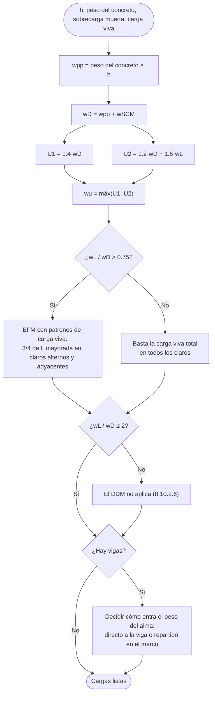

# S03 · Cargas

> [!abstract] En una frase
> Se integra la carga muerta, se mayora con las combinaciones del Código y se obtiene la carga última $w_u$; la relación $L/D$ decide si hay que alternar la carga viva.

## Por qué se hace

Los dos métodos de análisis trabajan con una carga uniforme por unidad de área. La carga **de servicio** ($w_D$, $w_L$) se usa en deflexiones; la **última** ($w_u$) en flexión y cortante.

## Cuándo se hace

Después de fijar el espesor, porque el peso propio depende de $h$. Si cambias $h$, esta sección se recalcula sola.

## Diagrama de flujo

## Procedimiento

### Paso 1 · Peso propio de la losa

$$w_{pp} = \gamma_c\, h$$

### Paso 2 · Carga muerta de servicio

$$w_D = w_{pp} + w_{SCM}$$

$w_{SCM}$ es la sobrecarga muerta: acabados, instalaciones bajo la losa, etc.

### Paso 3 · Combinaciones y carga última

$$U_1 = 1.4\,w_D \qquad U_2 = 1.2\,w_D + 1.6\,w_L \qquad w_u = \max(U_1, U_2)$$

- **Por qué dos:** $U_1$ gobierna solo cuando la carga viva es muy pequeña frente a la muerta.
- **Referencia:** ACI 5.3.1. Detalle en [[Combinaciones de carga y wu]].

### Paso 4 · Relación $L/D$ y patrones de carga

$$\frac{w_L}{w_D}\ \begin{cases}\le 0.75 & \text{carga viva total en todos los claros (ACI 6.4.3.2)}\\ > 0.75 & \text{patrones con } \tfrac34 \text{ de la carga viva mayorada (ACI 6.4.3.3)}\end{cases}$$

- **Por qué:** la carga viva puede estar en unos tableros y no en otros. Cargar claros alternos aumenta el momento positivo; cargar los dos claros vecinos a un apoyo aumenta su momento negativo. Si la carga viva es pequeña frente a la muerta, ese efecto es despreciable.
- Detalle en [[Patrones de carga viva]].

### Paso 5 · Peso del alma de las vigas

El alma de la viga que cuelga bajo la losa pesa $b_w\,(h_b - h)\,\gamma_c$ por metro. Hay dos maneras de tratarlo, ambas con respaldo:

| Opción | Qué hace | Cuándo usarla |
|---|---|---|
| **Directo a la viga** (por defecto) | No entra en el momento que se reparte a la losa; la viga lo resiste completo (ACI 318-14 §8.10.5.7.2). | Diseño de la losa: es lo físicamente correcto. |
| **Repartido en el ancho del marco** | Se suma como carga por área equivalente y se reparte entre franjas. | Para reproducir los ejemplos de PCA y StructurePoint; es conservador para la losa. |

Detalle en [[Peso del alma de las vigas]].

## Qué cambia según el caso

| Caso | Cambio |
|---|---|
| Uso distinto de parqueo | Otra carga viva: vivienda 200, oficinas 250, bodegas 500 kgf/m² o más (según la norma de cargas que aplique). |
| $L/D$ > 0.75 | El EFM corre cinco casos de carga y diseña con la envolvente. |
| $L/D$ > 2 | El DDM deja de ser válido; se diseña con EFM. |
| Losa sin vigas | No hay peso de alma que repartir. |

## Ejemplo HT1

| Concepto | Operación | Resultado |
|---|---|---|
| $w_{pp}$ | 2400 kgf/m³ × 0.15 m | 360 kgf/m² |
| $w_D$ | 360 + 50 | 410 kgf/m² |
| $U_1$ | 1.4 × 410 | 574 kgf/m² |
| $U_2$ | 1.2 × 410 + 1.6 × 250 | **892 kgf/m²** |
| $w_u$ | máx(574, 892) | **892 kgf/m²** (gobierna $U_2$) |
| $L/D$ | 250 / 410 | 0.61 ≤ 0.75 → sin patrones |

## Errores frecuentes

- Mayorar la carga para calcular deflexiones (se usan cargas de servicio).
- Olvidar recalcular el peso propio al cambiar el espesor.

Anterior: [[S02 Sistema estructural y geometría]] · Siguiente: [[S04 Rigidez de vigas y espesor mínimo]] · Índice: [[00 Inicio]]
