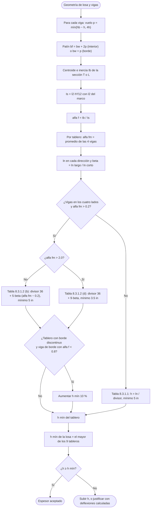

# S04 · Rigidez de vigas y espesor mínimo

> [!abstract] En una frase
> Se mide qué tan rígida es cada viga frente a la losa ($\alpha_f$) y, con el promedio del tablero ($\alpha_{fm}$) y la relación de claros ($\beta$), se obtiene el espesor mínimo que exime de calcular deflexiones.

## Por qué se hace

Un espesor suficiente controla las deflexiones sin tener que calcularlas. El Código da ese espesor en función de cuánto ayudan las vigas: si son rígidas, la losa puede ser más delgada. Además, $\alpha_f$ se vuelve a usar para repartir momentos en [[S05 Método de Diseño Directo]] y [[S06 Método del Marco Equivalente]].

## Cuándo se hace

Antes del análisis, con un espesor supuesto. Si $h < h_{mín}$ hay dos caminos: subir $h$, o seguir y demostrar con [[S10 Deflexiones]] que la losa cumple (ACI 8.3.2.1).

## Diagrama de flujo

## Procedimiento

### Paso 1 · Sección efectiva de la viga

![[F03-seccion-efectiva-viga.svg]]

$$p = \min(h_b - h,\ 4h)\qquad b_f = \begin{cases} b_w + 2p & \text{viga interior (T)}\\ b_w + p & \text{viga de borde (L)}\end{cases}$$

- **Por qué:** la viga y la losa se cuelan juntas; un tramo de losa a cada lado trabaja como patín. Ref. ACI 8.4.1.8. Ver [[Sección efectiva de viga]].

### Paso 2 · Inercia de la viga

Con el patín ($A_1 = b_f h$, centro a $h/2$) y el alma bajo la losa ($A_2 = b_w(h_b-h)$, centro a $h + (h_b-h)/2$), medidos desde la cara superior:

$$\bar y = \frac{A_1 y_1 + A_2 y_2}{A_1 + A_2}\qquad I_b = \frac{b_f h^3}{12} + A_1(\bar y - y_1)^2 + \frac{b_w (h_b-h)^3}{12} + A_2(\bar y - y_2)^2$$

### Paso 3 · Inercia de la franja de losa

![[F04-franja-de-losa-para-alfa-f.svg]]

$$I_s = \frac{\ell_2\,h^3}{12}$$

$\ell_2$ es el ancho de losa que «le toca» a la viga: de línea media a línea media de los tableros vecinos; en una viga de borde, medio tablero más la distancia del eje al borde de la losa.

### Paso 4 · Rigidez relativa

$$\alpha_f = \frac{E_{cb}\,I_b}{E_{cs}\,I_s}$$

Con el mismo concreto en viga y losa los módulos se cancelan. Ver [[Rigidez relativa alfa f]].

### Paso 5 · Promedio del tablero y relación de claros

![[F05-claros-libres-y-beta.svg]]

$$\alpha_{fm} = \frac{\alpha_{f1}+\alpha_{f2}+\alpha_{f3}+\alpha_{f4}}{4}\qquad \beta = \frac{\ell_{n,largo}}{\ell_{n,corto}}$$

$\ell_n$ se mide **entre caras de vigas** (o de columnas si no hay viga). Ver [[Claro libre ln]] y [[Relación de claros beta]].

### Paso 6 · Espesor mínimo

Con $\ell_n$ = claro libre **largo** y $f_y$ en psi:

| Condición | Espesor mínimo | Tabla |
|---|---|---|
| $\alpha_{fm} \le 0.2$ o sin vigas en los 4 lados | $\ell_n$ / divisor (ver abajo), no menor que 5 in | 8.3.1.1 |
| $0.2 < \alpha_{fm} \le 2.0$ | $\dfrac{\ell_n\,(0.8 + f_y/200\,000)}{36 + 5\beta(\alpha_{fm} - 0.2)} \ge 5\text{ in}$ | 8.3.1.2 (b)(c) |
| $\alpha_{fm} > 2.0$ | $\dfrac{\ell_n\,(0.8 + f_y/200\,000)}{36 + 9\beta} \ge 3.5\text{ in}$ | 8.3.1.2 (d)(e) |

Divisores de la Tabla 8.3.1.1 (sin ábacos), con interpolación lineal en $f_y$:

| $f_y$ (psi) | Exterior sin viga de borde | Exterior con viga de borde | Interior |
|---|---|---|---|
| 40 000 | 33 | 36 | 36 |
| 60 000 | 30 | 33 | 33 |
| 80 000 | 27 | 30 | 30 |

Un tablero exterior cuenta «con viga de borde» solo si esa viga tiene $\alpha_f \ge 0.8$.

### Paso 7 · Borde discontinuo

En tableros con un borde discontinuo, la viga de borde debe tener $\alpha_f \ge 0.80$; si no, el espesor de (b) o (d) se **aumenta 10 %** (ACI 8.3.1.2.1).

### Paso 8 · Decisión

$h_{mín}$ de la losa es el mayor de los nueve tableros. Ver [[Espesor mínimo de losa]].

## Qué cambia según el caso

| Caso | Qué pasa |
|---|---|
| Vigas rígidas ($\alpha_{fm}$ > 2) | El espesor depende solo de $\ell_n$ y $\beta$; es el caso de la HT1. |
| Vigas chatas o poco peraltadas | Baja $\alpha_{fm}$, entra la expresión (b) y el espesor sube. |
| Sin vigas interiores | Tabla 8.3.1.1: el espesor crece a $\ell_n/30$ o $\ell_n/33$. |
| Tablero más alargado | Sube $\beta$ y baja el espesor requerido (pero no por debajo del mínimo absoluto). |
| $f_y$ mayor | Sube el término $(0.8 + f_y/200\,000)$: más espesor. |

## Ejemplo HT1

Viga interior del eje 6 (dirección X), 35 × 60 con losa de 15:

| Cantidad | Operación | Resultado |
|---|---|---|
| $p$ | mín(60 − 15, 4·15) | 45 cm |
| $b_f$ | 35 + 2·45 | 125 cm |
| $\bar y$ | desde arriba | 21.20 cm |
| $I_b$ | ejes paralelos | 1 071 318 cm⁴ |
| $I_s$ | 536 · 15³ / 12 | 150 750 cm⁴ |
| $\alpha_f$ | 1 071 318 / 150 750 | **7.11** |

Todas las vigas: eje 5 y 8 (borde) 10.94 · ejes 6 y 7: 7.11 · eje E (borde) 11.87 · eje F 6.57 · eje I 5.69 · eje K (borde) 8.90.

Tablero que gobierna, **T2**: $\alpha_{fm}$ = (10.94 + 7.11 + 6.57 + 5.69)/4 = 7.57 > 2 · $\ell_{n,x}$ = 6.70 − 0.35 = 6.35 m · $\ell_{n,y}$ = 5.36 − 0.35 = 5.01 m · $\beta$ = 1.267.

$$h_{mín} = \frac{635\,(0.8 + 60\,000/200\,000)}{36 + 9(1.267)} = \frac{635 \times 1.10}{47.41} = 14.73\text{ cm} \ \rightarrow\ h = 15\text{ cm ✔}$$

Los tableros T1, T4 y T7 (claro de 4.90 m) piden solo 12.0 cm.

## Errores frecuentes

- Usar el claro entre ejes en lugar del claro libre.
- Tomar el peralte de la viga sin incluir la losa (aquí $h_b$ es el total).
- Promediar $\alpha_f$ de toda la planta: $\alpha_{fm}$ es **por tablero**.

Anterior: [[S03 Cargas]] · Siguiente: [[S05 Método de Diseño Directo]] · Índice: [[00 Inicio]]
