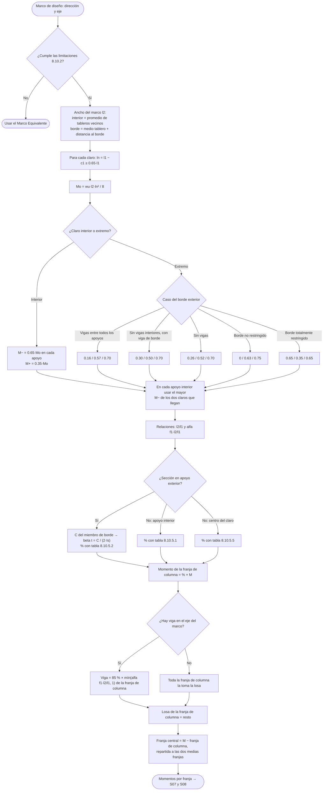

# S05 · Método de Diseño Directo (DDM)

> [!abstract] En una frase
> En cada claro de cada marco se calcula el momento estático total $M_o$ y se reparte con coeficientes: primero a lo largo (negativos y positivo) y luego a lo ancho (franja de columna, viga y franja central).

## Por qué se hace

Es el método más sencillo que permite el Código para losas regulares: no requiere resolver ninguna estructura, solo estática y tablas. Sirve como diseño y como control rápido del orden de magnitud de cualquier otro análisis.

## Cuándo se puede usar

Solo si se cumplen **todas** las limitaciones de ACI 318-14 §8.10.2 (ver [[Limitaciones del DDM]]). Si alguna falla, se diseña con [[S06 Método del Marco Equivalente]].

| Limitación | Artículo |
|---|---|
| Al menos tres claros continuos en cada dirección | 8.10.2.1 |
| Claros sucesivos que no difieran más de 1/3 del mayor | 8.10.2.2 |
| Tableros rectangulares con largo/corto ≤ 2 | 8.10.2.3 |
| Columnas desalineadas a lo sumo 10 % del claro | 8.10.2.4 |
| Solo cargas de gravedad uniformes | 8.10.2.5 |
| Carga viva de servicio ≤ 2 veces la muerta | 8.10.2.6 |
| Con vigas en los cuatro lados: $0.2 \le \dfrac{\alpha_{f1}\ell_2^2}{\alpha_{f2}\ell_1^2} \le 5$ | 8.10.2.7 |

## Diagrama de flujo

## Procedimiento

### Paso 1 · Ancho del marco $\ell_2$ y franjas

![[F06-franjas-de-diseno.svg]]

- **Marco interior:** $\ell_2$ = promedio de los dos tableros vecinos (de línea media a línea media).
- **Marco de borde:** $\ell_2$ = medio tablero + distancia del eje al borde de la losa (ACI 318-14 §8.10.3.2.3).
- **Franja de columna:** a cada lado del eje, un cuarto del menor entre $\ell_1$ y $\ell_2$ (ACI 8.4.1.5). **Franja central:** lo que queda entre dos franjas de columna (8.4.1.6).

Ver [[Marco de diseño y ancho l2]] y [[Franja de columna y franja central]].

### Paso 2 · Momento estático total

![[F07-momento-estatico.svg]]

$$\ell_n = \ell_1 - c_1 \ \ge\ 0.65\,\ell_1 \qquad\qquad M_o = \frac{w_u\,\ell_2\,\ell_n^2}{8}$$

- **Por qué:** por estática, en cualquier claro la suma del momento positivo más el promedio de los negativos vale $M_o$, sin importar cómo se reparta. Es el momento de una viga simplemente apoyada de ancho $\ell_2$ y claro $\ell_n$.
- Ver [[Momento estático Mo]] y [[Claro libre ln]].

### Paso 3 · Reparto longitudinal

![[F08-coeficientes-longitudinales.svg]]

**Claro interior:** $M^- = 0.65\,M_o$ en cada apoyo y $M^+ = 0.35\,M_o$.

**Claro extremo** (Tabla 8.10.4.2 de ACI 318-14):

| | Borde no restringido | Vigas entre todos los apoyos | Sin vigas interiores, sin viga de borde | Sin vigas interiores, con viga de borde | Borde totalmente restringido |
|---|---|---|---|---|---|
| $M^-$ interior | 0.75 | 0.70 | 0.70 | 0.70 | 0.65 |
| $M^+$ | 0.63 | 0.57 | 0.52 | 0.50 | 0.35 |
| $M^-$ exterior | 0 | 0.16 | 0.26 | 0.30 | 0.65 |

- **Apoyo interior:** se diseña con el **mayor** de los dos momentos negativos de los claros que llegan a él (8.10.4.5).
- Ver [[Coeficientes longitudinales del DDM]].

### Paso 4 · Reparto transversal: porcentaje de la franja de columna

![[F09-reparto-transversal.svg]]

Se entra a las tablas con $\ell_2/\ell_1$ y $\alpha_{f1}\ell_2/\ell_1$ (y $\beta_t$ en el apoyo exterior), interpolando linealmente:

| Sección | $\alpha_{f1}\ell_2/\ell_1$ | $\beta_t$ | $\ell_2/\ell_1$ = 0.5 | 1.0 | 2.0 |
|---|---|---|---|---|---|
| $M^-$ interior (8.10.5.1) | 0 | — | 75 | 75 | 75 |
| | ≥ 1.0 | — | 90 | 75 | 45 |
| $M^-$ exterior (8.10.5.2) | 0 | 0 | 100 | 100 | 100 |
| | 0 | ≥ 2.5 | 75 | 75 | 75 |
| | ≥ 1.0 | 0 | 100 | 100 | 100 |
| | ≥ 1.0 | ≥ 2.5 | 90 | 75 | 45 |
| $M^+$ (8.10.5.5) | 0 | — | 60 | 60 | 60 |
| | ≥ 1.0 | — | 90 | 75 | 45 |

> [!note] $\ell_2$ en un marco de borde
> Para **entrar a estas tablas**, en un marco de borde $\ell_2$ es el claro transversal completo del tablero (entre ejes), no el ancho reducido del marco. El ancho reducido se usa solo para $M_o$ e $I_s$.

Ver [[Porcentajes de la franja de columna]], [[Constante torsional C]] y [[Rigidez torsional beta t]].

### Paso 5 · Reparto entre viga y losa

$$M_{viga} = 0.85\,\min\!\left(\frac{\alpha_{f1}\ell_2}{\ell_1},\,1\right) M_{fc}\qquad M_{losa,fc} = M_{fc} - M_{viga}$$

Ver [[Reparto entre viga y losa]].

### Paso 6 · Franja central

$$M_{fcen} = M - M_{fc}$$

Se divide entre las dos medias franjas centrales del marco en proporción a sus anchos. La franja central **de un tablero** suma la media franja del marco de un lado y la del otro (8.10.6.2).

### Paso 7 · Momento por unidad de ancho

$$m_u = \frac{M_{franja}}{b_{franja}}$$

En la franja de columna con viga, el ancho de losa es el de la franja menos el alma: $b = b_{fc} - b_w$.

## Qué cambia según el caso

| Caso | Cambio |
|---|---|
| Losa sin vigas | $\alpha_{f1}$ = 0: 75 % del negativo interior y 60 % del positivo van a la franja de columna, y los resiste **la losa**. |
| Viga de borde poco rígida a torsión ($\beta_t$ pequeño) | El 100 % del momento exterior se concentra en la franja de columna. |
| Tablero alargado en dirección transversal ($\ell_2/\ell_1$ grande) | Con vigas, baja el porcentaje de la franja de columna hasta 45 %. |
| Viga flexible ($\alpha_{f1}\ell_2/\ell_1$ < 1) | La viga toma menos del 85 %, por interpolación lineal hasta 0. |

## Ejemplo HT1 · marco del eje 6, dirección X

$\ell_2$ = 5.36 m, $w_u$ = 892 kgf/m², $c_1$ = 0.50 m.

| Claro | $\ell_1$ | $\ell_n$ | $M_o$ | Coeficientes | $M^-$ izq | $M^+$ | $M^-$ der |
|---|---|---|---|---|---|---|---|
| E–F | 4.90 | 4.40 | 11.57 | 0.16 / 0.57 / 0.70 | 1.85 | 6.60 | 8.10 → **14.93** |
| F–I | 6.70 | 6.20 | 22.97 | 0.65 / 0.35 / 0.65 | 14.93 | 8.04 | 14.93 → **16.08** |
| I–K | 6.70 | 6.20 | 22.97 | 0.70 / 0.57 / 0.16 | 16.08 | 13.09 | 3.68 |

(tonf·m; las flechas indican el valor de diseño tras tomar el mayor de los dos claros en el apoyo.)

Comprobación de $M_o$ en F–I: $0.892 \times 5.36 \times 6.20^2 / 8 = 22.97$ tonf·m.

Reparto transversal del $M^-$ en el eje I, claro F–I ($M$ = 16.08):

| Cantidad | Operación | Resultado |
|---|---|---|
| $\ell_2/\ell_1$ | 5.36 / 6.70 | 0.80 |
| $\alpha_{f1}\ell_2/\ell_1$ | 7.11 × 0.80 | 5.69 ≥ 1 |
| % franja de columna | 90 − 15·(0.80 − 0.5)/0.5 | 81.0 % |
| Franja de columna | 0.81 × 16.08 | 13.03 |
| Viga | 0.85 × 13.03 | 11.07 |
| Losa de la franja de columna | 13.03 − 11.07 | 1.95 → 1.95 / 2.33 m = **0.84 tonf·m/m** |
| Franja central | 16.08 − 13.03 | 3.06 → 1.53 a cada tablero |

En el apoyo exterior E: $\ell_2/\ell_1$ = 1.094, $\beta_t$ = 582 362 / (2 × 150 750) = 1.93 → porcentaje = 100 − (100 − 72.2)(1.93/2.5) = **78.5 %**.

## Errores frecuentes

- Calcular $M_o$ con el claro entre ejes en vez de $\ell_n$.
- Olvidar tomar el mayor momento negativo en el apoyo interior cuando los claros vecinos son distintos.
- Dividir el momento de la franja de columna entre todo el ancho de la franja cuando hay viga (hay que quitar el alma y el 85 %).

Anterior: [[S04 Rigidez de vigas y espesor mínimo]] · Siguiente: [[S06 Método del Marco Equivalente]] · Índice: [[00 Inicio]]
