# S06 · Método del Marco Equivalente (EFM)

> [!abstract] En una frase
> Cada eje de columnas se convierte en un marco plano con tres tipos de miembro (losa-viga, columna y miembro a torsión); el marco se resuelve por distribución de momentos y los momentos resultantes se reparten a las franjas igual que en el DDM.

## Por qué se hace

El DDM usa coeficientes fijos; el EFM **calcula** el reparto longitudinal a partir de las rigideces reales, así que capta claros desiguales, columnas flexibles o rígidas y patrones de carga viva. No tiene las limitaciones geométricas del DDM.

## Cuándo se hace

Siempre que el DDM no aplique, y en esta hoja siempre, para diseñar con la envolvente de los dos métodos y para obtener los giros y momentos de servicio que usa [[S10 Deflexiones]].

## Diagrama de flujo

```mermaid
flowchart TD
    A(["Marco: dirección y eje"]) --> B["Isb de la sección completa:<br/>losa de ancho l2 + alma de la viga"]
    B --> C["Dentro de la columna: I = Isb / (1 − c2/l2)²"]
    C --> D["Integrar el miembro no prismático:<br/>k, FT y coeficiente m"]
    D --> E["Ksb = k·Ec·Isb / l1"]
    E --> F["Columna: Ic = c2·c1³/12, tramo rígido dentro del nudo"]
    F --> G["Kc = kc·Ec·Ic / lc (inferior y superior)"]
    G --> H["Miembro a torsión: C de la sección transversal"]
    H --> I["Kt = suma de 9·Ec·C / (l2·(1 − c2/l2)³)"]
    I --> J{"¿Viga paralela al marco?"}
    J -- Sí --> K["Kta = Kt·Isb / Is"]
    J -- No --> L["Kta = Kt"]
    K --> M["Kec = 1 / (1/suma Kc + 1/Kta)"]
    L --> M
    M --> N["Factores de distribución en cada nudo:<br/>FD = K / suma de K"]
    N --> O{"¿L/D > 0.75?"}
    O -- No --> P["Un caso: D + L mayoradas en todos los claros"]
    O -- Sí --> Q["Cinco casos: todos los claros, y 3/4 L en<br/>claros 1 y 3, claro 2, claros 1-2, claros 2-3"]
    P --> R["Momentos de empotramiento: m·w·l1²"]
    Q --> R
    R --> S["Distribución de momentos (Hardy Cross)<br/>hasta converger"]
    S --> T["Cortantes y diagrama de momentos de cada claro"]
    T --> U["M− en la cara del apoyo<br/>(interior: no más de 0.175·l1 del eje)"]
    U --> V["M+ máximo donde el cortante es cero"]
    V --> W["Envolvente de todos los casos"]
    W --> X{"¿Suma de M+ y promedio de M− > Mo?"}
    X -- "Sí, y se elige reducir" --> Y["Reducir en proporción (8.11.6.5)"]
    X -- No --> Z["Reparto transversal con las tablas del DDM"]
    Y --> Z
    Z --> ZZ(["Momentos por franja → S07 y S08"])
```

## Procedimiento

### Paso 1 · El modelo

![[F11-marco-equivalente.svg]]

La losa no se apoya en la columna en todo su ancho: lejos de la columna, la carga llega a través de un miembro transversal que se **tuerce**. Por eso la columna «real» es más flexible de lo que parece. Ver [[Marco equivalente]].

### Paso 2 · Rigidez de la losa-viga

![[F12-losa-viga-no-prismatica.svg]]

$$I_{sb}=\text{inercia bruta de la losa de ancho }\ell_2\text{ más el alma}\qquad I_{dentro\ de\ la\ columna}=\frac{I_{sb}}{(1-c_2/\ell_2)^2}$$

$$K_{sb} = \frac{k\,E_{cs}\,I_{sb}}{\ell_1}\qquad M_{emp} = m\,w\,\ell_1^2$$

- $k$, el factor de transporte FT y $m$ salen de integrar el miembro de inercia variable; equivalen a las tablas de ayudas de diseño de PCA. En un miembro prismático serían 4.0, 0.50 y 1/12.
- Ref. ACI 318-14 §8.11.3. Ver [[Miembro no prismático]] y [[Rigidez de la losa-viga Ksb]].

### Paso 3 · Rigidez de las columnas

![[F13-columna-con-zona-rigida.svg]]

$$I_c = \frac{c_2\,c_1^3}{12}\qquad K_c = \frac{k_c\,E_{cc}\,I_c}{\ell_c}$$

La columna es **infinitamente rígida dentro del nudo**, desde el eje de la losa hasta el fondo de la viga más peraltada que llega ($h_b - h/2$), o $h/2$ si no hay vigas. Eso hace $k_c$ > 4. Ref. §8.11.4. Ver [[Rigidez de la columna Kc]].

### Paso 4 · Miembro a torsión

![[F10-constante-torsional.svg]]

$$C=\sum\left(1-0.63\frac{x}{y}\right)\frac{x^3y}{3}\qquad K_t=\sum\frac{9\,E_{cs}\,C}{\ell_2\left(1-\dfrac{c_2}{\ell_2}\right)^3}$$

- La sección del miembro a torsión es la mayor entre: una franja de losa de ancho $c_1$; esa franja más la viga transversal; o la viga transversal con sus patines (§8.11.5.1).
- La suma es sobre los brazos a cada lado de la columna (dos en un marco interior, uno en uno de borde), cada uno con su $\ell_2$.
- **Con viga paralela al marco**, $K_t$ se multiplica por $I_{sb}/I_s$ (§8.11.5.2).
- Ver [[Miembro a torsión Kt]] y [[Constante torsional C]].

### Paso 5 · Columna equivalente

![[F14-columna-equivalente.svg]]

$$\frac{1}{K_{ec}}=\frac{1}{\sum K_c}+\frac{1}{K_{ta}}$$

Columnas y miembro a torsión trabajan **en serie**: se suman flexibilidades. Ver [[Columna equivalente Kec]].

### Paso 6 · Factores de distribución

![[F17-factores-de-distribucion.svg]]

$$FD_i=\frac{K_i}{K_{sb,izq}+K_{sb,der}+K_{ec}}$$

Ver [[Factores de distribución]].

### Paso 7 · Cargas y patrones

![[F15-patrones-de-carga.svg]]

Carga lineal del marco: $w = (1.2\,w_D + 1.6\,w_L)\,\ell_2$. Si $L/D$ > 0.75 se corren los patrones con ¾ de la carga viva mayorada y nunca se diseña con menos que el caso de carga total (ACI 6.4.3). Ver [[Patrones de carga viva]].

### Paso 8 · Distribución de momentos

1. Momentos de empotramiento $m\,w\,\ell_1^2$ en cada extremo.
2. En cada nudo, el desequilibrio se reparte con los FD (con signo contrario).
3. Cada momento repartido transporta FT × su valor al extremo opuesto.
4. Se repite hasta que lo transportado es despreciable; se suma cada columna.

La parte que toma la columna equivalente no se transporta. Ver [[Distribución de momentos (Hardy Cross)]].

### Paso 9 · Momentos de diseño

![[F16-momento-en-la-cara.svg]]

Con los momentos en los ejes $M_{izq}$, $M_{der}$ (negativos) y la carga $w$:

$$V_{izq}=\frac{w\ell_1}{2}+\frac{M_{der}-M_{izq}}{\ell_1}\qquad M(x)=M_{izq}+V_{izq}\,x-\frac{w x^2}{2}$$

- **Negativo de diseño:** en la cara del apoyo, $x = c_1/2$; en apoyos interiores, a no más de $0.175\,\ell_1$ del eje (§8.11.6.1).
- **Positivo de diseño:** en $x = V_{izq}/w$, donde el cortante es cero.
- Si se cumplen las limitaciones del DDM y $\tfrac12(M^-_{izq}+M^-_{der}) + M^+ > M_o$, se permite reducir los tres en proporción (§8.11.6.5). La hoja lo deja como opción, desactivada por defecto.

Ver [[Momento en la cara del apoyo]].

### Paso 10 · Reparto transversal

Idéntico al DDM (§8.11.6.6): pasos 4 a 7 de [[S05 Método de Diseño Directo]].

## Qué cambia según el caso

| Caso | Cambio |
|---|---|
| Losa sin vigas | $I_{sb} = \ell_2 h^3/12$; zona rígida de la columna = $h/2$; $C$ de la franja de losa $c_1 \times h$; no hay amplificación de $K_t$. |
| Entrepiso (columna arriba y abajo) | $\sum K_c$ suma las dos; el apoyo exterior toma más momento. |
| Columna articulada en la base | $K_c$ baja (rigidez con extremo lejano articulado). |
| $L/D$ > 0.75 | Cinco casos de carga y envolvente. |
| Claros muy distintos | El EFM lo capta; el DDM no (límite de 1/3). |

## Ejemplo HT1 · marco del eje 6, dirección X

| Cantidad | Valor |
|---|---|
| $I_{sb}$ | 1 601 835 cm⁴ |
| $I_{sb}/(1-c_2/\ell_2)^2$ | 1 601 835 / (1 − 50/536)² = 1 948 386 cm⁴ |
| Claro F–I: $k$, FT, $m$ | 4.128 · 0.509 · 0.0843 |
| $K_{sb}$ (F–I) | 4.128 × 253 456 × 1 601 835 / 670 = 25 017 tonf·m |
| $K_{sb}$ (E–F) | 34 579 tonf·m ($k$ = 4.173) |
| $I_c$ | 50 × 50³ / 12 = 520 833 cm⁴ |
| Zona rígida | 60 − 15/2 = 52.5 cm |
| $k_c$ y $K_c$ | 5.970 → 14 328 tonf·m |
| $C$ (nudo interior) | 622 356 cm⁴ |
| $K_t$ | 2 × 9 × 253 456 × 622 356 / [536 (1 − 50/536)³] = 71 062 tonf·m |
| $I_{sb}/I_s$ | 1 601 835 / 150 750 = 10.63 |
| $K_{ta}$ | 755 085 tonf·m |
| $K_{ec}$ | 1 / (1/14 328 + 1/755 085) = 14 062 tonf·m |

Factores de distribución (losa izq. / losa der. / columna): E — / 0.711 / 0.289 · F 0.469 / 0.340 / 0.191 · I 0.390 / 0.390 / 0.219 · K 0.640 / — / 0.360.

Cargas: $w_{u,D}$ = 1.2 × 410 × 5.36 = 2.637 tonf/m; $w_{u,L}$ = 1.6 × 250 × 5.36 = 2.144 tonf/m. Como $L/D$ = 0.61, un solo caso.

| Claro | $M_{emp}$ | $M^-$ eje izq | $M^-$ cara izq | $M^+$ | $M^-$ cara der | $M^-$ eje der |
|---|---|---|---|---|---|---|
| E–F | 9.72 | 2.52 | **0.37** | **6.34** | **11.41** | 14.82 |
| F–I | 18.10 | 15.60 | **11.95** | **8.61** | **16.92** | 20.98 |
| I–K | 18.10 | 22.19 | **17.77** | **12.82** | **3.62** | 6.90 |

(tonf·m; en negrita los de diseño. La distribución converge en 21 ciclos.)

![[F33-momentos-HT1-eje-6.svg]]

> [!note] Validación
> Con los datos del ejemplo «Two-Way Concrete Floor Slab with Beams» de StructurePoint, la hoja reproduce $K_{ec}$ (763.5 $E_c$ y 631.4 $E_c$), los factores de distribución (0.394 y 0.306) y los momentos en los ejes (93.1 / 167.7 / 153.6 kip·ft).

## Errores frecuentes

- Usar $K = 4EI/L$ para la losa-viga y la columna: se pierde el efecto de la zona de la columna.
- Olvidar amplificar $K_t$ cuando hay viga a lo largo del marco.
- Diseñar con los momentos en el eje en lugar de los de la cara del apoyo.

Anterior: [[S05 Método de Diseño Directo]] · Siguiente: [[S07 Momentos de diseño y comparación]] · Índice: [[00 Inicio]]
