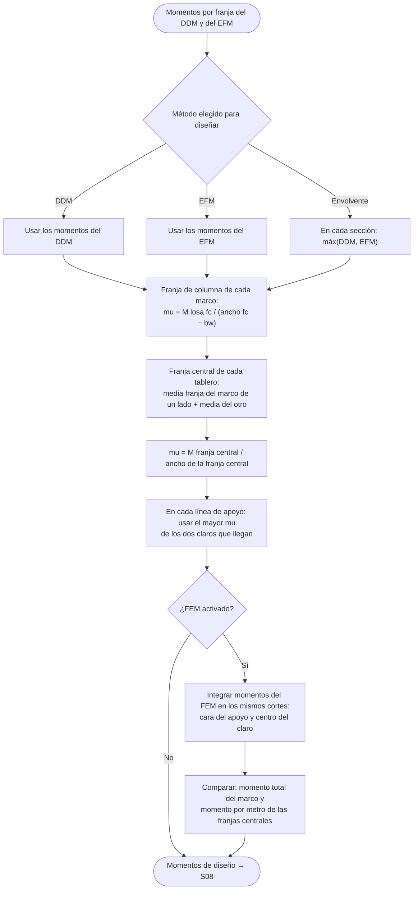

# S07 · Momentos de diseño y comparación DDM · EFM · FEM

> [!abstract] En una frase
> Se elige con qué momentos se arma la losa (DDM, EFM o la envolvente de ambos), se arman las franjas de cada tablero y se compara contra el modelo de elementos finitos.

## Por qué se hace

Los dos métodos del Código dan resultados parecidos pero no iguales. Diseñar con la **envolvente** (el mayor de los dos en cada sección) cubre ambos. El FEM no entra en el diseño: sirve para confirmar que los momentos manuales tienen el orden correcto.

## Diagrama de flujo

## Procedimiento

### Paso 1 · Elegir el método

| Opción | Cuándo conviene |
|---|---|
| **Envolvente DDM–EFM** (por defecto) | Proyecto académico o diseño conservador: cubre los dos métodos. |
| **DDM** | Para comprobar un cálculo hecho a mano con coeficientes. |
| **EFM** | Cuando el DDM no cumple sus limitaciones, o hay patrones de carga. |

Ver [[Momentos de diseño y envolvente]].

### Paso 2 · Armar las franjas

- **Franja de columna (losa):** pertenece a un marco. $m_u = M_{losa,fc}/(b_{fc} - b_w)$.
- **Franja central:** pertenece a un **tablero**; suma las dos medias franjas de los marcos que lo limitan:

$$M_{fcen,tablero}=M_{fcen}^{(marco\ A)}\frac{b_{media,A}}{b_{medias,A}}+M_{fcen}^{(marco\ B)}\frac{b_{media,B}}{b_{medias,B}}\qquad m_u=\frac{M_{fcen,tablero}}{b_{fcen}}$$

Ver [[Franja de columna y franja central]].

### Paso 3 · Apoyos interiores

Sobre un apoyo interior el bastón es una sola barra que cubre los dos claros. Se arma con el **mayor** momento por unidad de ancho de los dos lados.

### Paso 4 · Comparación con el FEM

La hoja corta el modelo de placa en las mismas secciones (cara de columna y centro del claro), integra el momento de la losa en el ancho de cada franja y suma el de la viga. Se comparan:

- **Momento total del marco** (viga + losa en todo $\ell_2$): debe parecerse al EFM.
- **Momento por metro de la franja central**: es lo que arma la losa.

Ver [[S12 Verificación FEM y ETABS]].

## Qué cambia según el caso

| Caso | Qué se observa |
|---|---|
| Vigas rígidas | El momento total del marco coincide bien entre EFM y FEM; el reparto transversal difiere más, porque las tablas del DDM son promedios. |
| Losa sin vigas | El FEM muestra picos junto a las columnas; por eso se compara el **promedio** de la franja, no el pico. |
| $L/D$ > 0.75 | El EFM incluye patrones y el FEM de la hoja no (carga total): el EFM queda por encima en los positivos. |

## Ejemplo HT1 · marco del eje 6, dirección X (tonf·m)

| Claro | Sección | DDM | EFM | FEM | Diseño |
|---|---|---|---|---|---|
| E–F | $M^-$ eje E | 1.85 | 0.37 | 0.26 | 1.85 |
| | $M^+$ | 6.60 | 6.34 | 6.63 | 6.60 |
| | $M^-$ eje F | 14.93 | 11.41 | 12.57 | 14.93 |
| F–I | $M^-$ eje F | 14.93 | 11.95 | 13.16 | 14.93 |
| | $M^+$ | 8.04 | 8.61 | 10.12 | 8.61 |
| | $M^-$ eje I | 16.08 | 16.92 | 18.68 | 16.92 |
| I–K | $M^-$ eje I | 16.08 | 17.77 | 19.57 | 17.77 |
| | $M^+$ | 13.09 | 12.82 | 14.26 | 13.09 |
| | $M^-$ eje K | 3.68 | 3.62 | 3.76 | 3.68 |

Franjas centrales, momento positivo por metro (tonf·m/m): la hoja da de 0.61 a 0.97 en X y de 0.45 a 0.90 en Y; el FEM, de 0.50 a 0.69 en X y de 0.44 a 0.79 en Y.

> [!important] Lectura de los resultados
> - El total del marco del FEM queda entre 4 % y 15 % por encima del EFM en casi todas las secciones. Parte de esa diferencia es esperada: el total del FEM incluye el momento del peso propio de las vigas, que con la opción «directo a la viga» no entra en el marco de la losa.
> - En la dirección Y, en los claros interiores, el FEM da **más** momento positivo en la franja central que los métodos manuales (por ejemplo 0.61 frente a 0.48 tonf·m/m). No cambia el armado porque el acero mínimo resiste 1.32 tonf·m/m, pero es el tipo de diferencia que esta comparación debe sacar a la luz.

Anterior: [[S06 Método del Marco Equivalente]] · Siguiente: [[S08 Diseño por flexión]] · Índice: [[00 Inicio]]
