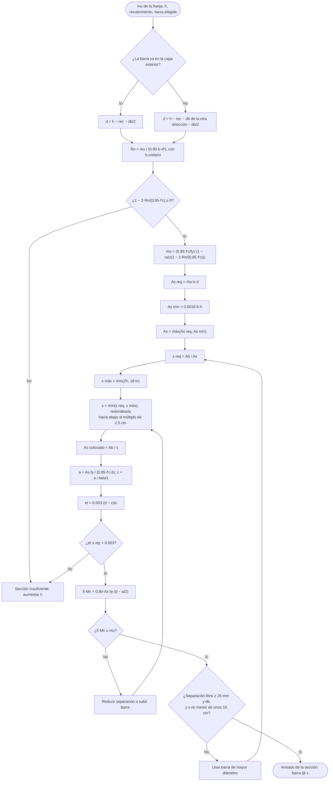

# S08 · Diseño por flexión

> [!abstract] En una frase
> Para cada franja y cada sección crítica se convierte el momento por metro en acero: se calcula la cuantía, se compara con el mínimo, se elige barra y separación en múltiplos de 2.5 cm y se comprueba la resistencia.

## Por qué se hace

Es el objetivo del proyecto: definir el refuerzo inferior (momentos positivos) y superior (momentos negativos) en las dos direcciones, cumpliendo resistencia, acero mínimo, separación máxima y ductilidad.

## Cuándo se hace

Después de tener los momentos de diseño por franja ([[S07 Momentos de diseño y comparación]]). Se repite para: 2 direcciones × (4 franjas de columna + 3 franjas centrales) × (3 claros abajo + 4 apoyos arriba) = 98 secciones.

## Diagrama de flujo

## Procedimiento

### Paso 1 · Peralte efectivo

![[F19-capas-y-peralte-efectivo.svg]]

$$d_{exterior} = h - rec - \frac{d_b}{2}\qquad d_{interior} = h - rec - d_{b,otra} - \frac{d_b}{2}$$

Las barras de las dos direcciones se cruzan, así que una queda más cerca de la cara y tiene más peralte. Conviene poner en la capa exterior la dirección con mayores momentos por metro. Ver [[Peralte efectivo d]] y [[Recubrimiento]].

### Paso 2 · Coeficiente de resistencia y cuantía

![[F18-flexion-ancho-unitario.svg]]

$$R_n=\frac{m_u}{\phi\,b\,d^2}\qquad \rho=\frac{0.85f'_c}{f_y}\left(1-\sqrt{1-\frac{2R_n}{0.85f'_c}}\right)\qquad A_{s,req}=\rho\,b\,d$$

con $\phi$ = 0.90 y $b$ = ancho unitario. Sale de igualar $\phi M_n = m_u$ con el bloque rectangular de compresión. Ver [[Coeficiente Rn y cuantía]].

### Paso 3 · Acero mínimo

$$A_{s,mín}=0.0018\,b\,h$$

Se coloca cerca de la cara en tensión, en la dirección del claro (ACI 8.6.1.1). Ver [[Acero mínimo]].

$$A_s=\max(A_{s,req},\,A_{s,mín})$$

### Paso 4 · Separación

![[F20-separacion-de-barras.svg]]

$$s_{req}=\frac{A_b}{A_s}\qquad s_{máx}=\min(2h,\ 18\text{ in})\qquad s=\min(s_{req},s_{máx})\ \text{redondeada a múltiplos de 2.5 cm}$$

> [!warning] Redondeo de la separación
> La hoja redondea **hacia abajo** por defecto: 26.3 cm pasa a **25 cm**. Redondear hacia arriba a 27.5 cm coloca 2.58 cm²/m, menos que el mínimo de 2.70 cm²/m, y no cumple ACI 8.6.1.1. Existe la opción «al múltiplo más cercano», y cuando deja menos acero que el requerido la hoja marca la sección con «As insuficiente».

Ver [[Separación de barras]].

### Paso 5 · Comprobación

$$A_{s,prov}=\frac{A_b}{s}\qquad a=\frac{A_{s,prov}f_y}{0.85f'_c\,b}\qquad c=\frac{a}{\beta_1}\qquad \varepsilon_t=0.003\,\frac{d-c}{c}$$

$$\phi M_n=\phi\,A_{s,prov}f_y\left(d-\frac{a}{2}\right)\ \ge\ m_u\qquad\qquad \varepsilon_t\ \ge\ \varepsilon_{ty}+0.003$$

Ver [[Resistencia de diseño a flexión]] y [[Sección controlada por tensión]].

## Listas de verificación de cada sección

| Verificación | Criterio | Artículo |
|---|---|---|
| Resistencia | $\phi M_n \ge m_u$ | 22.3 · 21.2.1 |
| Acero mínimo | $A_{s,prov} \ge 0.0018bh$ | 8.6.1.1 |
| Separación máxima | $s \le \min(2h, 18\text{ in})$ en secciones críticas | 8.7.2.2 |
| Separación libre mínima | ≥ 1 in, ≥ $d_b$, ≥ 4/3 del agregado | 25.2.1 |
| Ductilidad | $\varepsilon_t \ge \varepsilon_{ty} + 0.003$ | 8.3.3.1 · 21.2.2 |
| Recubrimiento | ≥ 3/4 in sin exposición; 1½ in (#5 y menores) o 2 in a la intemperie | Tabla 20.5.1.3.1 |

## Qué cambia según el caso

| Caso | Cambio |
|---|---|
| Momentos bajos (losa sobre vigas rígidas) | Gobierna el acero mínimo casi en todas partes. |
| Losa sin vigas | La franja de columna concentra 60 a 100 % del momento: separaciones cerradas; conviene #4 o #5. |
| Fuera de las secciones críticas | La separación máxima sube a mín(3$h$, 18 in). |
| Losa expuesta a la intemperie | Recubrimiento mayor → menos $d$ → más acero. |
| Barras de distinto diámetro en X y Y | Cambia $d$ de la capa interior. |

## Ejemplo HT1 · bastón de la franja central 6–7, apoyo I, dirección X

Datos: $h$ = 15 cm, rec = 2 cm, barras #3 ($d_b$ = 0.953 cm, $A_b$ = 0.71 cm²), capa exterior = barras ∥Y.

| Cantidad | Operación | Resultado |
|---|---|---|
| $d$ (X, capa interior) | 15 − 2 − 0.953 − 0.476 | 11.57 cm |
| $m_u$ | 3.376 tonf·m / 2.68 m | 1.260 tonf·m/m |
| $R_n$ | 126 000 / (0.90 × 100 × 11.57²) | 10.45 kgf/cm² |
| $\rho$ | fórmula | 0.00253 |
| $A_{s,req}$ | 0.00253 × 100 × 11.57 | 2.93 cm²/m |
| $A_{s,mín}$ | 0.0018 × 100 × 15 | 2.70 cm²/m |
| $s_{req}$ | 0.71 / 2.93 | 24.2 cm |
| $s$ | múltiplo de 2.5 hacia abajo | **22.5 cm** |
| $A_{s,prov}$ | 0.71 / 0.225 | 3.15 cm²/m |
| $a$ · $c$ | — | 0.56 cm · 0.66 cm |
| $\varepsilon_t$ | 0.003 (11.57 − 0.66)/0.66 | 0.050 ≥ 0.0051 ✔ |
| $\phi M_n$ | 0.90 × 3.15 × 4218 × (11.57 − 0.28) | 1.35 tonf·m/m → D/C = 0.93 ✔ |

**Armado resultante de la HT1:** #3 @ 25 cm en toda la cama inferior y en casi todos los bastones (gobierna el acero mínimo). Solo los bastones de las franjas centrales en X bajan a **#3 @ 20 cm** sobre el eje F y **#3 @ 22.5 cm** sobre el eje I.

![[F32-armado-HT1-direccion-X.svg]]

## Errores frecuentes

- Usar el mismo $d$ para las dos direcciones.
- Comparar $A_{s,mín}$ con $b\,d$ en lugar de $b\,h$ (en losas es con el área bruta).
- Redondear la separación hacia arriba sin volver a comprobar acero mínimo y resistencia.

Anterior: [[S07 Momentos de diseño y comparación]] · Siguiente: [[S09 Cortante en una dirección]] · Índice: [[00 Inicio]]
