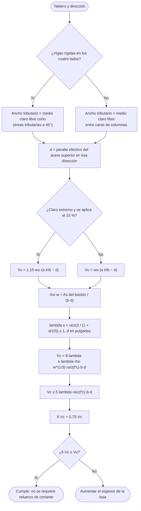

# S09 · Cortante en una dirección

> [!abstract] En una frase
> En cada tablero y en cada dirección se compara el cortante último por metro, a una distancia $d$ de la cara del apoyo, con la resistencia del concreto sin refuerzo de cortante.

## Por qué se hace

Una losa no lleva estribos: todo el cortante lo debe resistir el concreto. Si $V_u > \phi V_c$ la única salida práctica es **aumentar el espesor**. El proyecto pide revisar solo el cortante en una dirección (acción de viga), no el punzonamiento.

## Cuándo se hace

Después del diseño por flexión, porque la resistencia depende de la cuantía del acero colocado en el apoyo ($\rho_w$).

## Diagrama de flujo

## Procedimiento

### Paso 1 · Ancho tributario y cortante último

![[F21-cortante-areas-tributarias.svg]]

$$V_u = C_v\,w_u\,(a_{trib}-d)$$

- **Con vigas rígidas en los cuatro lados** ($\alpha_{f1}\ell_2/\ell_1 \ge 1$): la carga baja a las vigas por áreas tributarias limitadas por líneas a 45° (ACI 318-14 §8.10.8.1). La franja de losa más cargada tiene de ancho tributario **medio claro libre corto**, en las dos direcciones.
- **Sin vigas interiores:** acción de viga ancha; $a_{trib}$ = medio claro libre entre caras de columnas.
- **Sección crítica** a $d$ de la cara del apoyo (ACI 8.4.3.2), por eso se resta $d$.
- $C_v$ = 1.15 en el primer apoyo interior de un claro extremo (coeficiente del método simplificado, Tabla 6.5.4); 1.0 en los demás. Es opcional en la hoja.

Ver [[Cortante último Vu]].

### Paso 2 · Resistencia del concreto

$$V_c=8\,\lambda_s\,\lambda\,(\rho_w)^{1/3}\sqrt{f'_c}\;b_w\,d\ \le\ 5\,\lambda\sqrt{f'_c}\;b_w\,d\qquad\quad \lambda_s=\sqrt{\frac{2}{1+d/10}}\le 1.0$$

- Es la fila (c) de la Tabla 22.5.5.1: miembros **sin** refuerzo mínimo de cortante, con carga axial $N_u$ = 0.
- $\rho_w = A_s/(b_w d)$ con el acero superior a tensión en el apoyo; unidades psi e in.
- Ver [[Resistencia a cortante Vc]] y [[Efecto de tamaño lambda s]].

### Paso 3 · Verificación

$$\phi V_c = 0.75\,V_c\ \ge\ V_u$$

## Qué cambia según el caso

| Caso | Cambio |
|---|---|
| Losa sin vigas | El ancho tributario es medio claro libre **en cada dirección**, y en un diseño real además gobierna el **punzonamiento** (ACI 22.6), que aquí no se revisa. |
| Losa gruesa ($d$ > 10 in) | $\lambda_s$ < 1 reduce la resistencia. |
| Poco acero en el apoyo | $\rho_w^{1/3}$ baja $V_c$: una losa con acero mínimo resiste menos cortante que con la expresión clásica $2\sqrt{f'_c}$. |
| Concreto liviano | $\lambda$ < 1. |

## Ejemplo HT1 · caso que gobierna (T3, dirección X)

| Cantidad | Operación | Resultado |
|---|---|---|
| $a_{trib}$ | 5.01 m / 2 | 2.505 m |
| $d$ | acero superior ∥X | 11.57 cm = 4.56 in |
| $V_u$ | 1.15 × 0.892 × (2.505 − 0.116) | 2.45 tonf/m |
| $\rho_w$ | 3.15 / (100 × 11.57) | 0.00273 |
| $\lambda_s$ | $\sqrt{2/(1+0.456)}$ > 1 | 1.00 |
| $V_c$ | 8 × 1 × 1 × 0.00273^(1/3) × √4000 × b × d | 5.75 tonf/m |
| $V_{c,máx}$ | 5 × √4000 × b × d | 25.7 tonf/m |
| $\phi V_c$ | 0.75 × 5.75 | 4.31 tonf/m |
| D/C | 2.45 / 4.31 | **0.57 ✔** |

## Errores frecuentes

- Usar $V_c = 2\sqrt{f'_c}\,b_w d$ (edición 2014): en 318-19 esa expresión ya no aplica a miembros sin estribos.
- Meter $d$ en centímetros en $\lambda_s$.
- Olvidar restar $d$ al ancho tributario.

Anterior: [[S08 Diseño por flexión]] · Siguiente: [[S10 Deflexiones]] · Índice: [[00 Inicio]]
