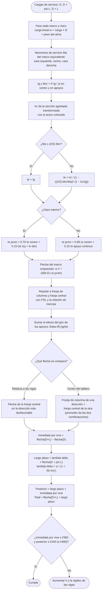

# S10 · Deflexiones

> [!abstract] En una frase
> Con cargas de servicio se calcula la flecha inmediata de cada tablero usando la inercia efectiva, se le suma la de largo plazo por cargas sostenidas y se compara con los límites $\ell/360$ y $\ell/240$ (o $\ell/480$).

## Por qué se hace

Una losa puede resistir y aun así deformarse demasiado: se agrietan acabados y muros, se encharca el agua, se nota a simple vista. El proyecto pide calcular la deflexión inmediata, la adicional dependiente del tiempo, la total y verificar los límites. Además, es la única forma de justificar un espesor menor que el mínimo (ACI 8.3.2).

## Cuándo se hace

Al final del diseño por resistencia, porque la rigidez agrietada depende del acero colocado.

## Diagrama de flujo

## Procedimiento

### Paso 1 · Niveles de carga

| Nivel | Carga | Para qué |
|---|---|---|
| D | $w_D$ | Base para separar la parte de carga viva |
| D + $\psi$L | $w_D + \psi\,w_L$ | Carga **sostenida**: genera la flecha de largo plazo |
| D + L | $w_D + w_L$ | Flecha inmediata total |

$\psi$ es la fracción de la carga viva que permanece: 0.25 en parqueos (criterio de clase).

### Paso 2 · Momento de agrietamiento e inercia agrietada

![[F23-seccion-agrietada.svg]]

$$M_{cr}=\frac{f_r\,I_g}{y_t}$$

- **Centro del claro:** sección T del marco completo (losa de ancho $\ell_2$ + alma); tensión abajo.
- **Apoyos:** alma rectangular de la viga ($b_w \times h_b$), o la losa completa si no hay viga; tensión arriba.
- $I_{cr}$: sección agrietada transformada con $n = E_s/E_c$ y el acero **colocado**. Como las vigas no se diseñan aquí, su acero se estima con su momento último, sin bajar del mínimo de vigas.

Ver [[Momento de agrietamiento Mcr]] e [[Inercia agrietada Icr]].

### Paso 3 · Inercia efectiva

![[F22-inercia-efectiva.svg]]

$$I_e=\begin{cases} I_g & M_a\le \tfrac23 M_{cr}\\[6pt] \dfrac{I_{cr}}{1-\left(\dfrac{(2/3)M_{cr}}{M_a}\right)^2\left(1-\dfrac{I_{cr}}{I_g}\right)} & M_a> \tfrac23 M_{cr}\end{cases}$$

Tabla 24.2.3.5 de ACI 318-19. Promedio del claro:

$$I_{e,prom}=0.70\,I_{e,m}+0.15\,(I_{e,1}+I_{e,2})\ \text{(dos extremos continuos)}\qquad I_{e,prom}=0.85\,I_{e,m}+0.15\,I_{e,cont}\ \text{(un extremo continuo)}$$

Ver [[Inercia efectiva Ie]].

### Paso 4 · Flecha de cada franja (franjas cruzadas)

![[F24-franjas-cruzadas.svg]]

$$\Delta_{marco}=\frac{w\,\ell^4}{384\,E_c\,I_{e,prom}}$$

$$\Delta_c=FDL_c\,\Delta_{marco}\frac{I_{marco}}{I_c}+\Delta_{\theta,izq}+\Delta_{\theta,der}\qquad \Delta_m=FDL_m\,\Delta_{marco}\frac{I_{marco}}{I_m}+\Delta_{\theta,izq}+\Delta_{\theta,der}$$

$$FDL_c=\frac12\left[\%^{+}+\frac{\%^{-}_{izq}+\%^{-}_{der}}{2}\right]\qquad FDL_m=1-FDL_c\qquad \Delta_\theta=\theta\,\frac{\ell}{8}\,\frac{I_g}{I_e}$$

- **Por qué:** el marco se trata como una viga doblemente empotrada; la franja de columna y la central se reparten esa flecha según el momento que toman (porcentajes del DDM) y su propia inercia. El giro real de los apoyos agrega flecha.
- Ver [[Método de las franjas cruzadas]].

### Paso 5 · Flecha del tablero

![[F25-flecha-relativa.svg]]

| Medida | Expresión | Uso |
|---|---|---|
| **Relativa a las vigas** (por defecto con vigas) | $\Delta_{rel} = \Delta_{m}$ de la dirección más desfavorable | Cómo se lee en ETABS en clase: flecha del centro menos el promedio de las dos vigas de apoyo |
| **Centro del tablero** | $\Delta = \tfrac12[(\Delta_{cx}+\Delta_{my})+(\Delta_{cy}+\Delta_{mx})]$ | Flecha absoluta respecto a las columnas (ACI 435R); única opción sin vigas |

Ver [[Flecha relativa a las vigas]].

### Paso 6 · Largo plazo y totales

![[F26-flechas-y-limites.svg]]

$$\lambda_\Delta=\frac{\xi}{1+50\rho'}\qquad \Delta_{i,L}=\Delta_{i,D+L}-\Delta_{i,D}\qquad \Delta_{LP}=\lambda_\Delta\,\Delta_{i,sost}$$

$$\Delta_{post}=\Delta_{LP}+\Delta_{i,L}\qquad\qquad \Delta_{total}=\Delta_{i,D+L}+\Delta_{LP}$$

$\xi$ = 2.0 para 5 años o más; $\rho'$ = 0 porque la losa no lleva acero de compresión, así que $\lambda_\Delta$ = 2. Ver [[Deflexión a largo plazo]].

### Paso 7 · Límites

| Condición | Flecha que se limita | Límite |
|---|---|---|
| Pisos que no soportan elementos frágiles | Inmediata por carga viva | $\ell/360$ |
| Soportan elementos no estructurales **no** propensos a dañarse | Posterior a su colocación | $\ell/240$ |
| Soportan elementos propensos a dañarse | Posterior a su colocación | $\ell/480$ |

Tabla 24.2.2. Ver [[Límites de deflexión]].

## Qué cambia según el caso

| Caso | Cambio |
|---|---|
| Losa sin vigas | Solo la flecha del centro del tablero; $I_g$ de los apoyos es la losa completa; las flechas son mucho mayores. |
| Muros de mampostería sobre la losa | Límite $\ell/480$. |
| Uso con más carga viva permanente (bodegas) | $\psi$ mayor → más flecha de largo plazo. |
| Momento de servicio apenas sobre ⅔ $M_{cr}$ | $I_e$ cae bruscamente: en 318-19 la flecha crece mucho más que con la fórmula de Branson de 318-14. |
| Comparación con ETABS | En clase se usa 0.25 de la inercia de la losa; la hoja permite poner esos modificadores en el FEM. |

## Ejemplo HT1 · tablero T6 (el más exigido)

Marco del eje 6, dirección X, claro I–K, nivel D + L:

| Cantidad | Valor |
|---|---|
| $w$ | (410 + 250) × 5.36 + peso del alma = 3.92 tonf/m |
| $M_a$ (cara I / centro / cara K) | 14.55 / 10.50 / 2.96 tonf·m |
| Centro: $I_g$, $y_t$, $M_{cr}$ | 1 601 835 cm⁴ · 47.59 cm · 11.23 tonf·m |
| Centro: $I_{cr}$ | 141 734 cm⁴ |
| Apoyo: $I_g$, $M_{cr}$ | 630 000 cm⁴ · 7.00 tonf·m |
| ¿Agrieta el centro? | 10.50 > ⅔ × 11.23 = 7.49 → sí |
| $I_e$ centro | 141 734 / [1 − (7.49/10.50)² (1 − 0.0885)] = 263 876 cm⁴ |
| $I_{e,prom}$ | 0.85 × 263 876 + 0.15 × 336 412 = 274 757 cm⁴ (0.17 $I_g$) |
| $\Delta_{marco}$ | 3.92 × 620⁴ / (384 × 253 456 × 274 757) = 0.216 cm |
| $FDL_c$ · $FDL_m$ | 0.821 · 0.179 |
| $\Delta_m$ | 0.179 × 0.216 × (1 601 835 / 75 375) + 0.032 + 0.182 = 1.04 cm |

Resultado del tablero (flecha relativa, franja X, $\ell$ = 6.70 m):

| | D | D + $\psi$L | D + L |
|---|---|---|---|
| Flecha inmediata | 0.13 cm | 0.27 cm | 1.04 cm |

- $\Delta_{i,L}$ = 1.04 − 0.13 = **0.91 cm** ≤ 670/360 = 1.86 cm ✔
- $\Delta_{LP}$ = 2 × 0.27 = 0.53 cm
- $\Delta_{post}$ = 0.53 + 0.91 = **1.44 cm** ≤ 670/240 = 2.79 cm ✔
- $\Delta_{total}$ = 1.04 + 0.53 = **1.57 cm**

El FEM elástico con secciones brutas da 0.23 cm para D + L en el mismo punto: la diferencia es el agrietamiento.

## Errores frecuentes

- Calcular con cargas mayoradas.
- Aplicar $\lambda_\Delta$ a la flecha total en lugar de solo a la sostenida.
- Usar $M_{cr}$ como umbral de agrietamiento: en 318-19 el umbral es ⅔ $M_{cr}$.
- Comparar la flecha absoluta de ETABS (que incluye lo que bajan las vigas) con el límite de la losa.

Anterior: [[S09 Cortante en una dirección]] · Siguiente: [[S11 Detallado del refuerzo]] · Índice: [[00 Inicio]]
