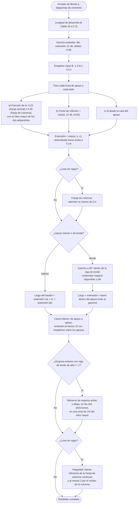

# S11 · Detallado del refuerzo

> [!abstract] En una frase
> Se define hasta dónde llega cada barra: longitud de desarrollo, gancho en los bordes, empalmes de la cama inferior, extensión de los bastones desde la cara de cada apoyo y refuerzo especial de las esquinas.

## Por qué se hace

El acero calculado solo trabaja si está **anclado**: una barra necesita cierta longitud embebida para desarrollar su fluencia. El proyecto pide que el resultado permita saber qué refuerzo colocar, dónde y hasta dónde extenderlo.

## Cuándo se hace

Al final, con el armado de flexión definido (barra y separación en cada franja) y los diagramas de momento del marco equivalente.

## Diagrama de flujo

## Procedimiento

### Paso 1 · Longitud de desarrollo

$$\ell_d=\left(\frac{f_y\,\psi_t\,\psi_e\,\psi_g}{25\,\lambda\sqrt{f'_c}}\right)d_b\ \ge 12\text{ in}$$

Válida para barras #6 y menores con separación libre ≥ $2d_b$ y recubrimiento ≥ $d_b$ (lo normal en una losa). Si no se cumple, el divisor baja de 25 a 50/3. Para #7 y mayores, 20 en lugar de 25. Ver [[Longitud de desarrollo ld]].

### Paso 2 · Gancho estándar

![[F28-gancho-estandar.svg]]

$$\ell_{dh}=\left(\frac{f_y\,\psi_e\,\psi_r\,\psi_o\,\psi_c}{55\,\lambda\sqrt{f'_c}}\right)d_b^{1.5}\ \ge\ \max(8d_b,\ 6\text{ in})$$

Gancho a 90°: extensión recta de $12d_b$ y diámetro interior de doblez de $6d_b$ (#3 a #8). Ver [[Gancho estándar ldh]].

### Paso 3 · Empalme por traslape

$$\ell_{st}=1.3\,\ell_d\ \ge 12\text{ in}\quad\text{(clase B)}$$

Ver [[Empalme por traslape]].

### Paso 4 · Extensión de los bastones

![[F27-extension-del-baston.svg]]

Medida desde la **cara del apoyo**, es la mayor de:

$$\ell_{ext}=\max\Big(\underbrace{k\,\ell_n}_{\text{Fig. 8.7.4.1.3}},\ \ \underbrace{x_{PI}+\max(d,\ 12d_b,\ \ell_n/16)}_{\text{7.7.3.8.4}},\ \ \underbrace{\ell_d}_{\text{anclaje}}\Big)$$

- $k$ = 0.22 en franja central y 0.30 en franja de columna; con claros vecinos desiguales se usa el **mayor** (8.7.4.1.3b).
- $x_{PI}$ = distancia de la cara del apoyo al punto de inflexión del diagrama de momentos (donde el momento cambia de signo).
- **Por qué el punto de inflexión:** hasta ahí hay tensión arriba; más allá el bastón ya no hace falta, pero debe prolongarse para anclarse y cubrir el corrimiento del diagrama por cortante. Es el mismo criterio visto en clase para vigas: desde donde deja de ser necesario, extender el mayor de $d$ o $12d_b$.
- Se redondea hacia arriba al múltiplo de 5 cm para facilitar el corte.

Ver [[Extensión de bastones]].

### Paso 5 · Anclaje en el borde

El refuerzo negativo perpendicular a un borde discontinuo debe anclarse en la viga de borde para desarrollarse en la cara del apoyo (ACI 8.7.4.1.2): gancho a 90°. Se comprueba que el espacio disponible (ancho de la viga menos el recubrimiento) sea ≥ $\ell_{dh}$.

### Paso 6 · Cama inferior

![[F29-empalme-inferior.svg]]

- De apoyo a apoyo, entrando **al menos 6 in (15 cm)** en vigas, columnas o muros (ACI 8.7.4.1.1).
- Si se empalma, el traslape clase B se ubica **sobre los apoyos**, donde el momento positivo es nulo.

Ver [[Anclaje del refuerzo inferior]].

### Paso 7 · Refuerzo de esquina

![[F30-refuerzo-de-esquina.svg]]

En esquinas exteriores con vigas de borde de $\alpha_f$ > 1.0: refuerzo **arriba y abajo**, para el mayor momento positivo por metro del tablero, en una zona de **un quinto del claro mayor** desde la esquina, con barras paralelas a los lados en las dos direcciones (ACI 8.7.3.1). Ver [[Refuerzo de esquina]].

### Paso 8 · Integridad estructural (solo losas sin vigas)

Todas las barras inferiores de la franja de columna continuas o con empalme clase B, y al menos dos por dirección pasando por el núcleo de la columna (ACI 8.7.4.2).

## Qué cambia según el caso

| Caso | Cambio |
|---|---|
| Losa sin vigas | Extensiones mínimas de la Fig. 8.7.4.1.3 obligatorias; la franja de columna no baja de 5$d$; integridad estructural. |
| Con vigas | El Código no fija fracciones: mandan el punto de inflexión y $\ell_d$; la hoja mantiene además las fracciones como mínimo práctico. |
| Barras superiores con más de 30 cm de concreto debajo | $\psi_t$ = 1.3 (no ocurre en losas delgadas). |
| Barras muy juntas (menos de $6d_b$) | $\psi_r$ = 1.6 en el gancho. |
| Sin viga de borde | El anclaje se hace dentro de la propia losa (8.7.4.1.2). |

## Ejemplo HT1 (barras #3, $d_b$ = 0.95 cm)

| Longitud | Operación | Resultado |
|---|---|---|
| $\ell_d$ | [60 000 / (25 × 63.25)] × 0.375 in = 14.2 in | 36 cm |
| $\ell_{dh}$ | fórmula = 4.3 in → mínimo 6 in | 15 cm |
| Extensión del gancho | 12 × 0.95 | 11.4 cm |
| Empalme clase B | 1.3 × 36 | 47 cm |

Bastón de la franja central sobre el eje I, hacia F (dirección X, $\ell_n$ = 6.20 m):

| Condición | Valor |
|---|---|
| 0.22 $\ell_n$ | 1.36 m |
| Punto de inflexión 1.38 m + máx(0.116, 0.114, 6.20/16 = 0.39) | **1.77 m** |
| $\ell_d$ | 0.36 m |
| Extensión adoptada | **1.80 m** |

Largos de bastones (franja central / franja de columna):

| Apoyo | Dirección X | Apoyo | Dirección Y |
|---|---|---|---|
| Eje E (borde) | 1.45 / 1.80 m | Eje 5 (borde) | 1.55 / 1.95 m |
| Eje F | 3.35 / 4.30 m | Eje 6 | 3.15 / 3.50 m |
| Eje I | 4.00 / 4.30 m | Eje 7 | 3.15 / 3.50 m |
| Eje K (borde) | 1.85 / 2.35 m | Eje 8 (borde) | 1.55 / 1.95 m |

Cama inferior: 4.75 m y 6.55 m en X; 5.20 m en Y (claro libre más 15 cm por lado). Gancho en vigas de borde: disponible 35 − 2 = 33 cm ≥ 15 cm ✔. Refuerzo de esquina: #3 @ 25 cm arriba y abajo en ambas direcciones, zona de 1.10 m (T1, T7) y 1.35 m (T3, T9).

![[F32-armado-HT1-direccion-X.svg]]

## Errores frecuentes

- Medir la extensión desde el eje de la columna en lugar de la cara.
- Cortar todos los bastones a $L/4$ sin revisar el punto de inflexión.
- Empalmar la cama inferior en el centro del claro.

Anterior: [[S10 Deflexiones]] · Siguiente: [[S12 Verificación FEM y ETABS]] · Índice: [[00 Inicio]]
