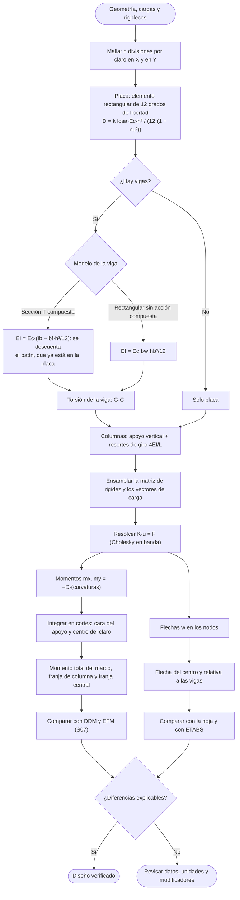

# S12 · Verificación por elementos finitos y ETABS

> [!abstract] En una frase
> Un modelo de placa con vigas y columnas, resuelto dentro de la propia hoja, da momentos y flechas independientes de los métodos manuales; una tabla permite contrastar además con ETABS.

## Por qué se hace

El enunciado pide usar el Método de Elementos Finitos **solo como verificación**. Comparar tres resultados obtenidos por caminos distintos (coeficientes, marco equivalente y placa) es la mejor forma de detectar un error de datos o de procedimiento.

## Cuándo se hace

Al final, con el diseño terminado. También es útil durante el diseño para ver la forma de la deformada y los mapas de momento.

## Diagrama de flujo

## Procedimiento

### Paso 1 · El modelo

![[F31-modelo-de-elementos-finitos.svg]]

- **Losa:** placa delgada (teoría de Kirchhoff). Cada nodo tiene tres grados de libertad: la flecha $w$ y las pendientes $\partial w/\partial x$ y $\partial w/\partial y$.
- **Vigas:** barras sobre los ejes, con flexión y torsión.
- **Columnas:** impiden la flecha en el nudo y aportan resortes de giro.
- **Carga:** presión uniforme en todos los tableros más el peso del alma de las vigas.

Ver [[Elemento finito de placa]].

### Paso 2 · Rigideces

$$D=\frac{k_{losa}\,E_c\,h^3}{12(1-\nu^2)}\qquad m_x=-D\left(\frac{\partial^2 w}{\partial x^2}+\nu\frac{\partial^2 w}{\partial y^2}\right)\qquad m_y=-D\left(\frac{\partial^2 w}{\partial y^2}+\nu\frac{\partial^2 w}{\partial x^2}\right)$$

$m_x$ es el momento por metro que arma el acero **paralelo a X**.

### Paso 3 · Modificadores de rigidez

| Ajuste | Losa | Vigas | Columnas | Torsión | Viga |
|---|---|---|---|---|---|
| **Secciones brutas** (por defecto) | 1.0 | 1.0 | 1.0 | 1.0 | Sección T |
| **Como ETABS de clase** | 0.25 | 0.35 | 0.70 | 0.10 | Rectangular |

- **Brutas:** para comparar **momentos** con DDM y EFM, que también usan secciones brutas.
- **ETABS de clase:** para comparar con el modelo «HT1 - SHELLS», que usa secciones agrietadas.

Ver [[Modificadores de rigidez]].

### Paso 4 · Momentos de franja

Se corta el modelo en la cara de la columna y en el centro del claro, y se integra $m_x$ (o $m_y$) a lo ancho:

$$M_{franja}=\int_{ancho} m\,dy\ (+\,M_{viga})$$

### Paso 5 · Comparación con ETABS

En ETABS (sin vigas secundarias, losa de 15 cm) se leen:

1. **M11 y M22** por unidad de ancho en el centro de cada tablero, con la combinación 1.2D + 1.6L.
2. **La flecha** por D + L: la del centro del tablero **menos** el promedio de las dos vigas de apoyo, si se compara la flecha relativa.

Se escriben en la tabla de la sección 12 de la hoja, que calcula la diferencia. Ver [[Comparación con ETABS]].

## Qué cambia según el caso

| Caso | Cambio |
|---|---|
| Losa sin vigas | Aparecen picos de momento sobre las columnas: comparar promedios de franja, no picos. |
| Malla más fina | Mejora la precisión cerca de columnas; 8 divisiones por claro bastan para franjas. |
| Modificadores de ETABS | Cambia el reparto entre losa y vigas (0.35/0.25) y crecen las flechas. |
| $L/D$ > 0.75 | El FEM de la hoja no alterna cargas; el EFM sí. |

## Ejemplo HT1

- Malla de 24 × 24 elementos, 1875 grados de libertad; $D$ = 742.5 tonf·m.
- Momentos positivos por metro de las franjas centrales (tonf·m/m):

| Tablero | $m_x$ hoja | $m_x$ FEM | $m_y$ hoja | $m_y$ FEM |
|---|---|---|---|---|
| T1 / T7 | 0.66 | 0.54 | 0.78 | 0.53 |
| T2 / T8 | 0.63 | 0.61 | 0.84 | 0.76 |
| T3 / T9 | 0.97 | 0.69 | 0.90 | 0.79 |
| T4 | 0.63 | 0.50 | 0.45 | 0.44 |
| T5 | 0.61 | 0.55 | 0.48 | 0.61 |
| T6 | 0.93 | 0.65 | 0.52 | 0.66 |

- Flecha elástica por D + L (secciones brutas, relativa a las vigas): entre 0.08 y 0.23 cm.

> [!note] Validación del elemento
> Una placa cuadrada simplemente apoyada con carga uniforme da un coeficiente de flecha de 0.00408 frente al exacto de 0.00406. Con el ejemplo de StructurePoint, el momento total del marco interior del FEM difiere menos de 1 % del EFM en el claro interior.

## Errores frecuentes

- Comparar momentos del FEM con modificadores de agrietamiento contra métodos manuales con secciones brutas.
- Leer en ETABS el pico sobre la columna en lugar del valor en la franja.
- Olvidar que el modelo de ETABS original tiene vigas secundarias y losa de 10 cm.

Anterior: [[S11 Detallado del refuerzo]] · Índice: [[00 Inicio]]
